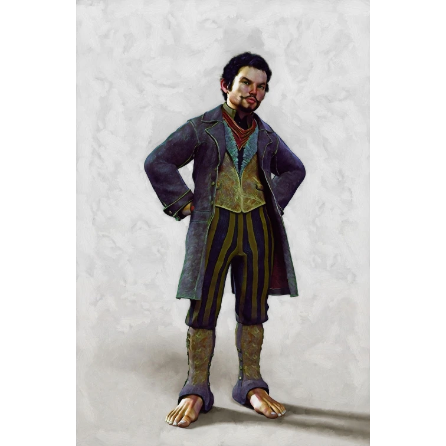

_Burmistrz [[Woodhike]]._

## Opis
Przedstawiciel małych ras w regionie [[Estoria|Estorii]]. Thobos jest przyjaznym niziołkiem, który z wielką gościnnością przyjmuje gości w swoim domu, zawsze oferując herbatę. Dba o interesy mieszkańców Woodhike i dwa razy w roku podróżuje do [[Mytros]], by reprezentować tamtejszą społeczność.

## Osobowość
Uczynny, chętnie pomaga bohaterom.

## Historia
W [[Sesja 6 - Problemy w Woodhike]] bohaterowie dotarli do Woodhike i spotkali burmistrza Thobosa, który opowiedział im o zaginionych zwierzętach i ściętych drzewach w okolicy. Później pokonali bandytów pod wodzą [[Korteva|Kortevy]].

Thobos poprosił ich o pomoc w rozwiązaniu tej sprawy, wierząc, że za kłopotami stoją ludzcy kłusownicy. Po pokonaniu grupy Kortevy zaproponował przygarnięcie [[Przyjazny Cyklop|przyjaznego cyklopa]] do swojej społeczności.
