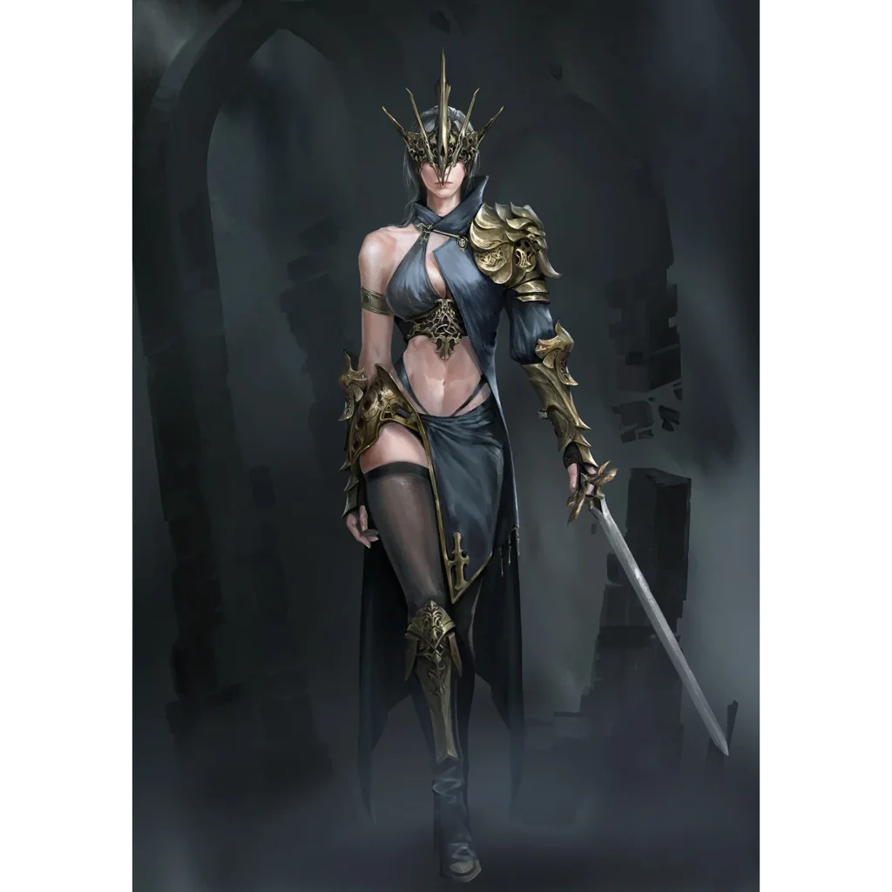

_Furia, Starsza niż Bliźniacy_

## Opis
Jedna z trzech [[Furie|Furii]], bogiń zemsty i strażniczek praw.

## Osobowość
Powściągliwa strażniczka praw.

## Historia
Została stworzona przez samą [[Thylea|Thyleę]] na początku świata, by pełnić rolę strażniczki praw.

W [[Sesja 75 - Koniec Przysięgi]] wraz z siostrami [[Megara|Megarą]] i [[Alecto]] przyjęła drużynę w komnacie w wieży [[Praxys]]. Furie ujawniły wiek i pochodzenie swojego rodu: są starsze niż [[Sydon]] i [[Lutheria]], stworzone przez Thyleę. Wyjawiły też bohaterom sekret gwiazdy na szczycie Praxys.
