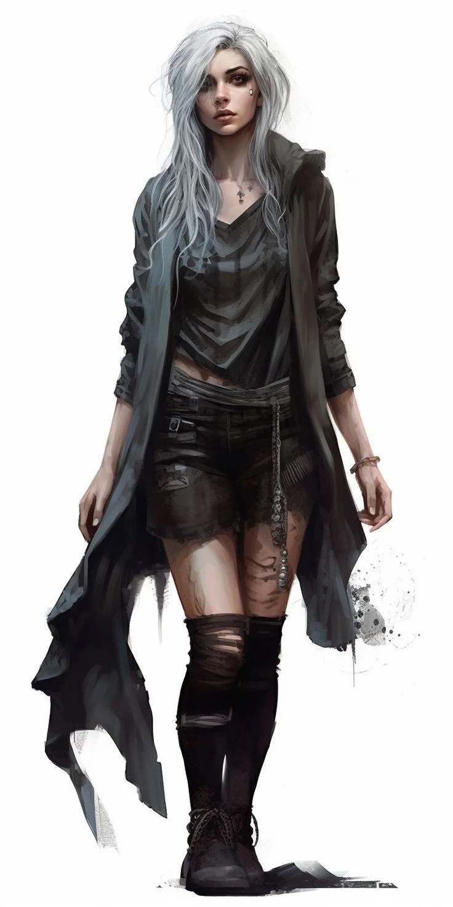

_Kobieta, którą [[Versir]] uznał za godną zostania jedną z trzech nowych [[Mojry|Mojr]]. Odmówiła._

## Opis
Inteligentna i uważna. Potrafi dostrzec konsekwencje ludzkich decyzji, których inni nie zauważają. Nie jest nieomylną wyrocznią i nie zna przyszłości w sposób absolutny: jej siłą jest rozumienie ludzi, rozpoznawanie zagrożeń i dostrzeganie, dokąd prowadzą ich wybory.

## Osobowość
Wie, ile cierpienia zostawiły po sobie rządy [[Tytani|Tytanów]], ale nie wierzy, że da się uchronić ludzi przed każdym nieszczęściem; nawet najlepsza rada nie gwarantuje szczęśliwego zakończenia. Nadal ostrzega przed zagrożeniami i dzieli się wiedzą, lecz pilnuje, by nie przedstawiać własnego osądu jako jedynej słusznej odpowiedzi. Pokazuje ludziom możliwości, konsekwencje i niepewność, której nie da się usunąć. Uważa, że nawet jeśli potrafi dostrzec przyszłość, nie ma prawa wybierać jej za innych.

## Historia
Kiedyś przyszli do niej rodzice ciężko chorej dziewczynki. Miejscowa uzdrowicielka była bezradna, ale na odległej wyspie było rzadkie lekarstwo. Ojciec chciał po nie popłynąć, choć podróż przez niebezpieczne wody mogła go zabić. Anisadora poradziła mu, by najpierw szukał innych dróg; ojciec jej zaufał i został. Lekarstwa nie zdobyto na czas i dziecko zmarło.

Gdy później ojciec zapytał ją, czy jego córka mogłaby żyć, gdyby jednak wyruszył, Anisadora po raz pierwszy ujrzała inną przyszłość: mężczyznę, który przeżywa rejs, znajduje lekarstwo i wraca na czas, i dziewczynkę, która zdrowieje. Przyznała, że tak. Ojciec nie oskarżył jej o to, że nie przewidziała przyszłości. Powiedział tylko, że nie przyszedł po gwarancję sukcesu, lecz po pomoc w decyzji, a ona pozwoliła, by jej strach przesądził za niego. Ten ciężar nosi do dziś.

## Odmowa
Po wojnie z Tytanami [[Versir]] szukał kandydatek na nowe Mojry i zobaczył w niej to, czego szukał: mądrość, rozwagę, rozumienie ludzi i brak pragnienia władzy. Zaczął ją przygotowywać, lecz zbyt szybko potraktował ją jak przyszłą Mojrę i za mocno naciskał.

Anisadora nie odmówiła ze strachu ani dlatego, że uznała się za niegodną, i nie odrzuciła samej idei nowych Mojr. Bała się, że ludzie zaczną traktować Mojry jak istoty, które wiedzą, co powinno się wydarzyć: władcy będą pytać o wojny, rodziny szukać gwarancji bezpieczeństwa, a zwykli ludzie przestaną ufać własnym osądom i dobrowolnie oddadzą komuś władzę nad swoim życiem. Nie chciała też poświęcić życia obowiązkowi, którego sama nie wybrała.

> Nie chcę, by inni popełniali ten sam błąd, oddając mi ciężar, który należy do nich. A jako Mojra nie byłabym już tylko kobietą, której ufają. Byłabym kimś, kogo autorytet mógłby sprawić, że przestaliby ufać samym sobie.
>
> Nie wątpię, że [[Thylea]] potrzebuje kogoś, kto będzie o nią dbał. Wątpię jednak, czy powinna potrzebować kogoś, kto ma rozstrzygać, jak ma wyglądać jej przyszłość.

Versir uważa tę odmowę za swoją największą porażkę. Wciąż widzi w niej jedną z najlepszych kandydatek i nadal jej ufa, ale szanuje jej prawo do decyzji. Zrozumiał, że traktował ją tak, jak ona kiedyś potraktowała tamtego ojca: uznał, że wie, co powinna zrobić. Ich drogi mogą się jeszcze skrzyżować.
