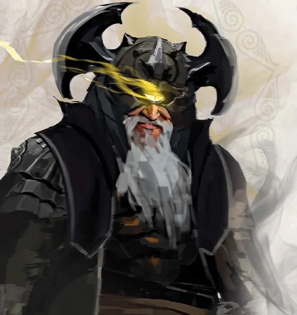

_Cyklop, wyznawca [[Sydon|Sydona]], uwolniony z więzienia Kieł; po wojnie kowal przy kowadle [[Mithralowa Kuźnia|Mithralowej Kuźni]]._

## Opis
Potężny cyklop, niegdyś przykuty w lochach [[Więzienie Kieł|Kła]]. Jest utalentowanym kowalem, co widać po jakości jego prac.

## Osobowość
Głęboko religijny, wierny wyznawca [[Sydon|Sydona]]; w więzieniu początkowo brał bohaterów za posłańców Boga Mórz.

Jest dumny ze swojego kunsztu i wdzięczny za ratunek.

## Historia
Zanim bohaterowie przybyli do Mytros, wykuł magiczną tarczę z symbolem [[Lutheria|Lutherii]] na urodziny królowej [[Thessilea|Thessilei]].

W [[Sesja 32 - Kieł]] bohaterowie spotkali go w więzieniu Kieł, przykutego do podłogi. Początkowo myślał, że to Bóg Mórz wysłał ich na jego ratunek, i poprosił o uwolnienie, ale drużyna nie była w stanie go wtedy uwolnić. W [[Sesja 33 - W Szponach Bazyliszków]] bohaterowie postanowili wrócić do fortecy po uwięzionego cyklopa, a w [[Sesja 34 - Ivello i Drapaczka do Pleców]] uwolnili go z więzienia (z pomocą zaklęć [[Arevon Elorrenthi|Arevona]]) i przenieśli na statek.

W [[Sesja 36 - Królowa, Dziedzic i Generał]] drużyna skierowała się na [[Wyspa Ognia|Wyspę Ognia]] zgodnie z życzeniem uwolnionego cyklopa. W [[Sesja 37 - Próba Ognia]] Bront zszedł z bohaterami na ląd i dowiedział się, że jego syn [[Steros]] zajął jego miejsce jako kowal dla króla jaszczuroludzi [[Jankor|Jankora]]; był wściekły, że syn musi pracować w takim miejscu. Jaszczuroludzie nie potrzebowali już Bronta. Po bitwie ([[Sesja 38 - Bitwa w Kalderze]]) wrócił ze Sterosem do wioski jaszczuroludzi.

W [[Sesja 84 - Świt Nowej Ery]], po tym jak [[Volkan]] osiadł u boku [[Orestes|Orestesa]] w [[Orestessos Zythikē]], Bront przejął jego obowiązki przy kowadle w [[Mithralowa Kuźnia|Mithralowej Kuźni]] i okazał się kowalem na tyle dobrym, że godnie zastąpił boga. Jego syn [[Steros]], jankan i lepszy rzemieślnik od ojca, tego czasu nie doczekał: zginął w pierwszej fali [[Sesja 76 - Bitwa o Mytros: Pierwsza Fala|Bitwy o Mytros]].
