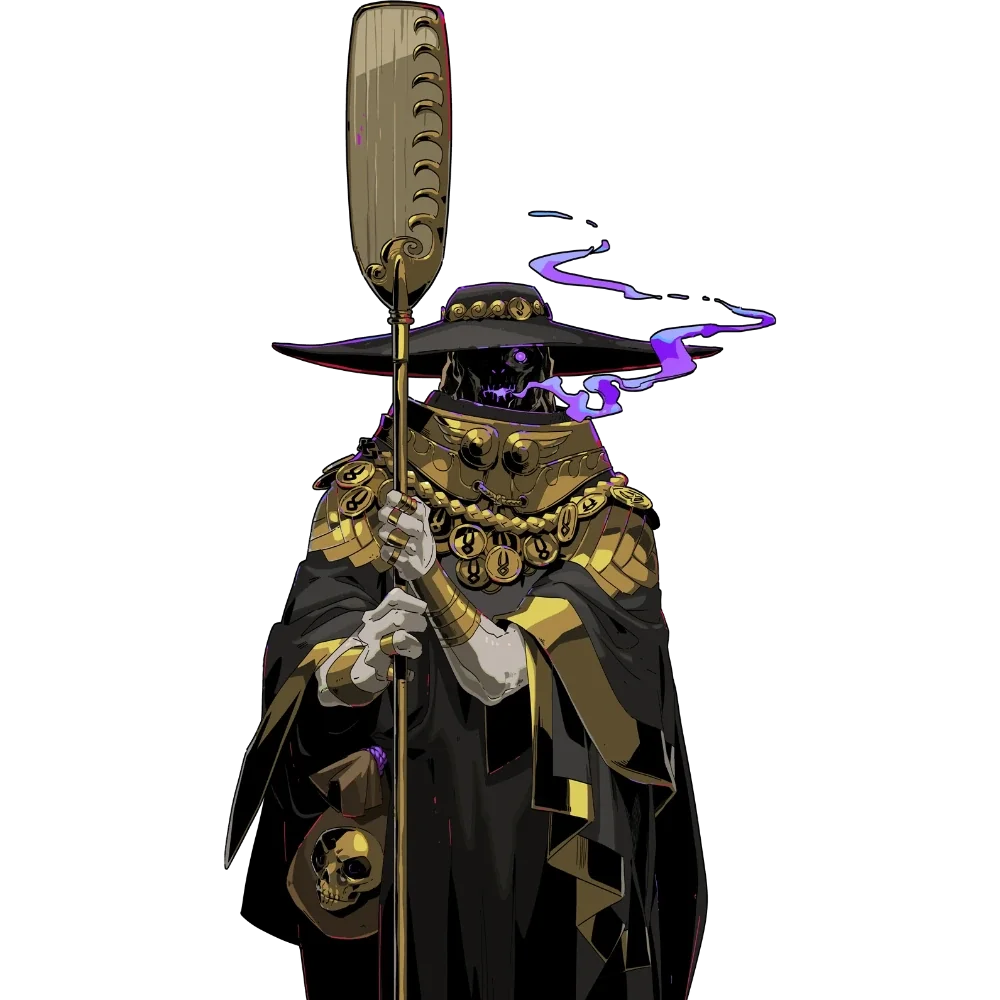

_Przewoźnik po rzece Styks_

## Opis
Wysoka, wychudła, zakapturzona postać w purpurowych szatach, o świecących w mroku oczach. Nie mówi – porozumiewa się jedynie głuchymi pomrukami i jękami. Chętnie przyjmuje złote obole: poza przewożeniem dusz prowadzi też handel.

Przewoźnik dusz zmarłych, na którego nad rzeką [[Styks]] w [[Hades|Hadesie]] czeka niekończąca się kolejka dusz. Pobiera opłatę od zmarłych.

## Historia
W [[Sesja 41 - Wiedźma Lotosu]] bohaterowie zobaczyli w wizji Hadesu, jak Charon pobiera opłatę od zmarłych.

W [[Sesja 60 - Typhon Symfonia Potępienia i Brama do Hadesu]] bohaterowie, którzy wkroczyli do Hadesu, zobaczyli go w oddali; dusze cierpliwie czekały nad Styksem na swojego przewoźnika. W [[Sesja 61 - Yala, Arezja i Żółw]] zjawa [[Gaius|Gaiusa]] w kolejce ściskała w dłoni monety dla Charona.
