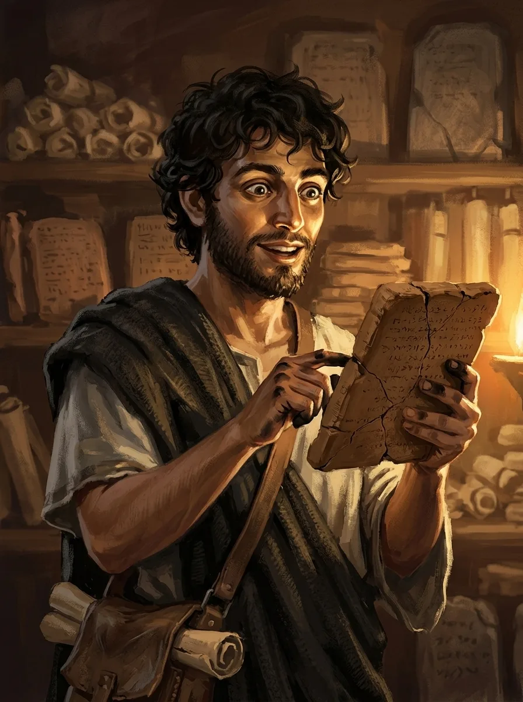

_Młody historyk i badacz, uczeń [[Versir|Versira]], znawca Ery Tytanów._

## Opis
Młody historyk i badacz. Dziś jeden z najlepszych znawców historii Ery [[Tytani|Tytanów]], z dostępem do ogromnej ilości informacji o jej wydarzeniach, miejscach i ludziach.

## Osobowość
Nie potrafi pogodzić się z tym, że bliscy mogą po prostu zniknąć z historii. Nie szuka jednak ich dusz, tylko imion, historii i dowodów na to, że istnieli.

## Historia
Pochodzi z rodziny powiązanej z dawnymi strukturami [[Tytani|Tytanów]], której historię po ich upadku niemal całkowicie wymazano: część dokumentów zniszczono, a część celowo przekłamano. Zaczął więc sam szukać prawdy o swoich przodkach.

Po wojnie z Tytanami zainteresował się nim [[Versir]], który dostrzegł w nim coś bardzo znajomego, i zaczął go szkolić w pracy z dawnymi źródłami: porównywaniu kronik, rozpoznawaniu propagandy i odróżnianiu legend od faktów. Z czasem Edran stworzył własne archiwum poświęcone Erze Tytanów. Versir pomagał mu je rozwijać, ale nigdy nie pozwolił nazwać go swoim imieniem ani uczynić z niego miejsca kultu. Nadal korzysta z jego pracy — Edran może trafić na nowy trop w sprawach, których Versir wciąż nie zamknął: jego rodziny, Gwiezdnej Stali, [[Talieus Pierwszy|Talieusa]], dawnych Tytanów czy przyszłej [[Mojry|Mojry]].
