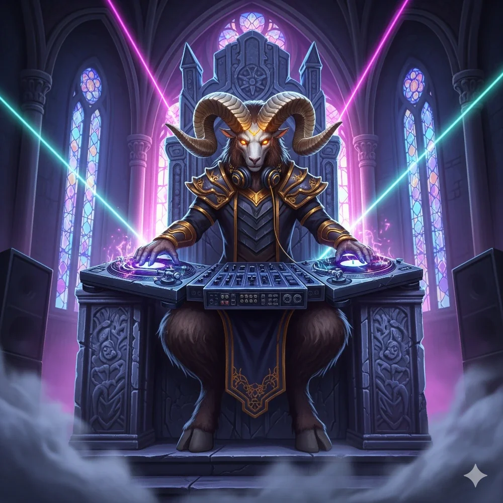

_DJ Koźlak na Latającej Fortecy_

## Opis
Koźlak, który pełnił rolę DJ-a na niekończącej się imprezie [[Talieus Pierwszy|Talieusa]]. Bardziej zna się na rytmie niż na nawigacji.

## Osobowość
Skupiony na muzyce i rytmie.

## Historia
W [[Sesja 60 - Typhon Symfonia Potępienia i Brama do Hadesu]], po śmierci Talieusa i końcu imprezy, bohaterowie porozmawiali z DJ-em koźlakiem Groonarem, który okazał się raczej specjalistą od rytmu niż od nawigacji. Drużyna przejęła kontrolę nad latającą fortecą i tymczasowo zatrzymała gości jako załogę sprzątającą.

Groonar został, by zapewniać rozrywkę podczas wielkiego sprzątania.
