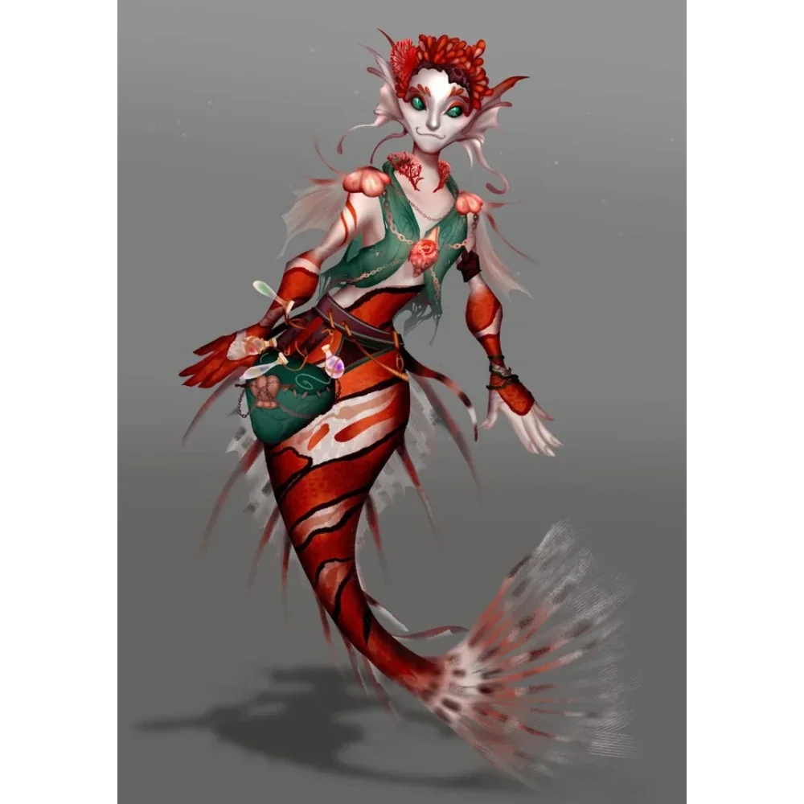

_Syrena/Merfolk, córka [[Hywin|Hywina]]; po wojnie wróciła do swojego ludu._

## Opis
Młodzieńcza i ciekawa świata przedstawicielka Merfolków.

## Osobowość
Otwarta, pomocna i odważna. Pragnienie poznania świata przeważyło nad tradycją jej ludu.

## Historia
W [[Sesja 31 - Wyprawa na Themis]] zaprowadziła drużynę do swojego ojca, [[Hywin|Hywina]].

Wbrew jego woli zdecydowała się opuścić swój lud i dołączyła do załogi [[Ultros|Ultrosa]], pragnąc przeżyć wielką przygodę u boku bohaterów.

W [[Sesja 84 - Świt Nowej Ery]] przez pierwsze powojenne lata pomagała przy odbudowie od strony morza, na ile mogła, by ostatecznie wrócić do swojego ludu z całym workiem historii do opowiedzenia.
