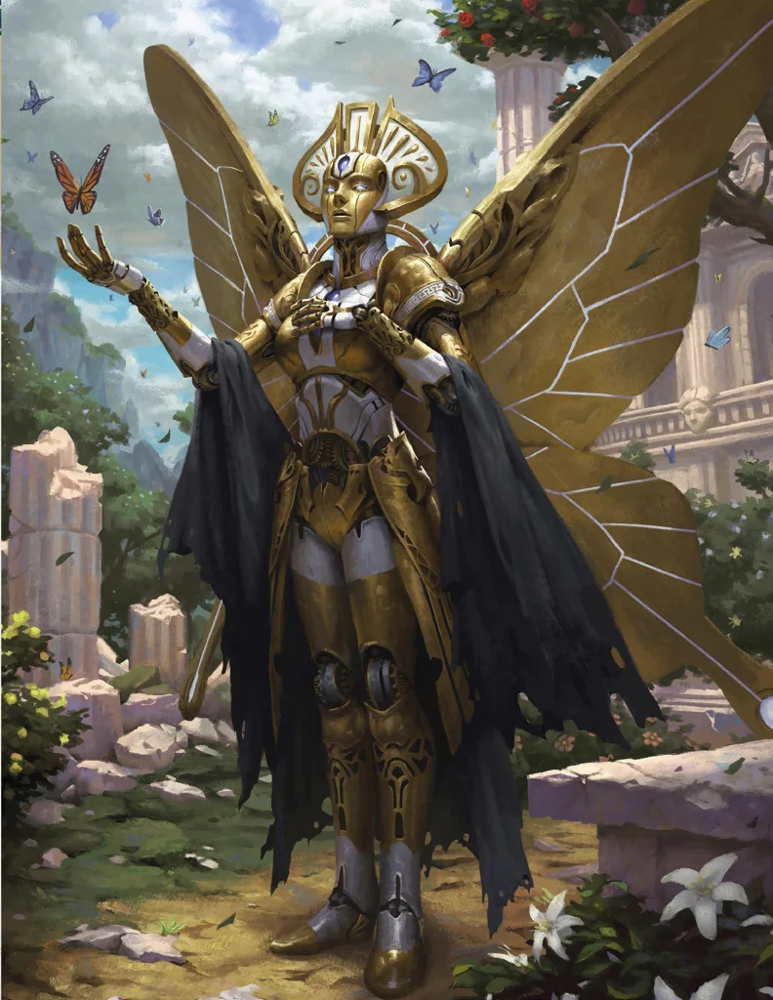

_Mechaniczny posłaniec, opisany w książce Volkana._

## Historia
Prawdopodobnie jest to zaawansowany automaton stworzony przez boga kowali.

W [[Sesja 21 - Ukryte pragnienia Ismene]] [[Arevon Elorrenthi|Arevon]] znalazł w [[Akademia Mytros|Akademii]] książkę „Golemy i Automatony" autorstwa [[Volkan|Volkana]], zawierającą informacje o Keledone; okazało się, że [[Ismene Neurdagon]] wcześniej wypożyczała tę książkę.

W [[Sesja 31 - Wyprawa na Themis]] Keledone jest wymieniony wśród tych, którzy dołączyli do drużyny przed wyprawą na Themis. W [[Sesja 36 - Królowa, Dziedzic i Generał]] [[Orestes]] wykorzystał go do wysłania sadzonki swojemu wujowi. W [[Sesja 46 - Morderca z Wyspy Wygnańców]] wrócił jako mechaniczny posłaniec (ptak), przynosząc różdżkę z rogu smoka; Orestes przekazał mu list do wuja z prośbą o informacje o liściach koki.

W [[Sesja 55 - Egida Mytros]] wylądował na [[Ultros|Ultrosie]], niosąc w ramionach samego Volkana, który przekazał [[Arevon Elorrenthi|Arevonowi]] naprawioną i ulepszoną Antikyterę, a [[Felicjan Janus Twardowski|Felicjanowi]] nową różdżkę ze smoczego rogu. W [[Sesja 70 - Audiencja u Pani Snów]] ponownie przyniósł Volkana na rękach do Ultrosa, który tym razem przybył z darami, o które prosili bohaterowie.
