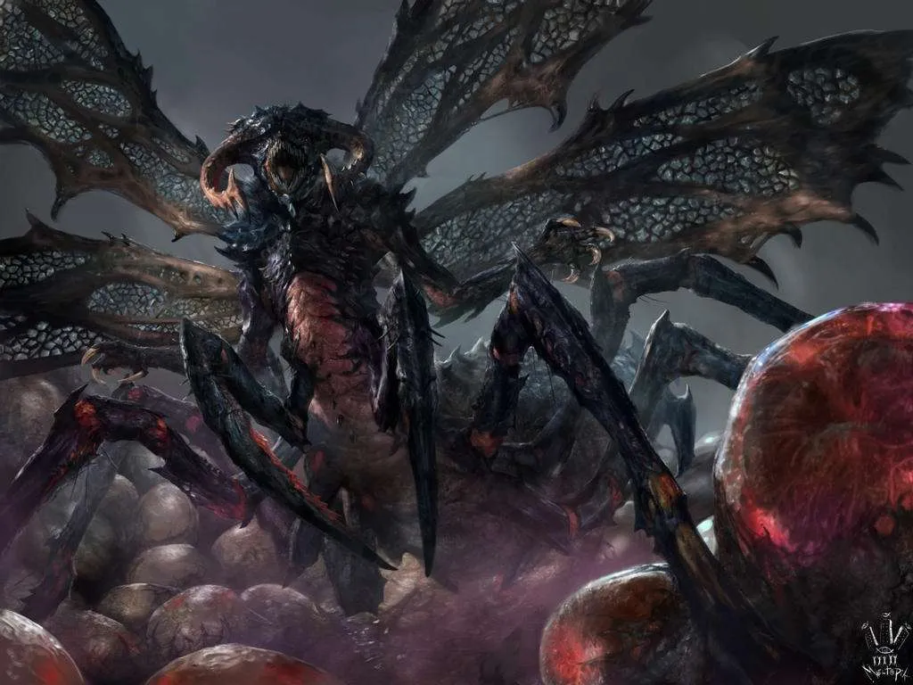

_Matka insektoidalnego roju, olbrzymia i śmiercionośna istota, która zginęła spętana w trzewiach Praxys._

## Opis
Makabryczna, olbrzymia insektoidalna bestia o twardym pancerzu, matka [[Myrmeki|Myrmeków]]. Porozumiewa się telepatycznie. Zabita przez [[Orion Xul|Oriona]] w [[Sesja 71 - Infiltracja Praxys]].

## Osobowość
Telepatycznie przekonywała bohaterów: „Inne ludy nie są moimi wrogami. Chcemy żyć w spokoju.". Za uwolnienie obiecywała gigantyczną nagrodę i wypuszczenie swojego wściekłego pomiotu na wrogą twierdzę, by zniszczyć ją od środka. Rój, który wezwała, był jednak głodny, ekspansywny i szybko się uczył, co – jak uznał [[Versir]] – czyniło go zagrożeniem dla całej [[Kontynent Thylea|Thylei]].

Darzy swoje potomstwo i "lud" swoistą matczyną troską. <!-- UNSOURCED -->

## Historia
Została uwięziona w specjalnej celi w wieży [[Praxys]]. <!-- UNSOURCED -->

W [[Sesja 71 - Infiltracja Praxys]] drużyna odnalazła ją za dwoma rzędami zamkniętych drzwi, spętaną sześcioma gigantycznymi łańcuchami i pilnowaną przez dwóch opancerzonych, bezgłowych Blemysów. Gdy tylko drzwi się otworzyły, strażnicy w amoku rzucili się nie na intruzów, lecz na samą Królową i zaczęli ją szlachtować. Królowa telepatycznie błagała bohaterów o uwolnienie. [[Orestes]] rozciął jeden z łańcuchów, a drużyna powaliła Blemysów, lecz wtedy na tyłach celi pojawiły się wezwane na odsiecz roje [[Myrmeki|Myrmeków]]. [[Versir]] uznał, że wypuszczenie tak głodnej i ekspansywnej plagi zagroziłoby całemu ekosystemowi [[Kontynent Thylea|Thylei]], i zdecydował o ataku, nie zważając na jej błagania. [[Orion Xul|Orion]] przebił włócznią pancerz Królowej, zadając jej śmiertelny cios, a [[Felicjan Janus Twardowski|Felicjan]] Ścianą Ognia odgrodził nadciągający rój – Myrmeki natychmiast skopiowały to zaklęcie, tworząc własną ścianę płomieni. Uczyły się jednak na tyle wolno, że drużyna wybiła je, a ich zdolność adaptacji utwierdziła bohaterów w słuszności decyzji Versira.
