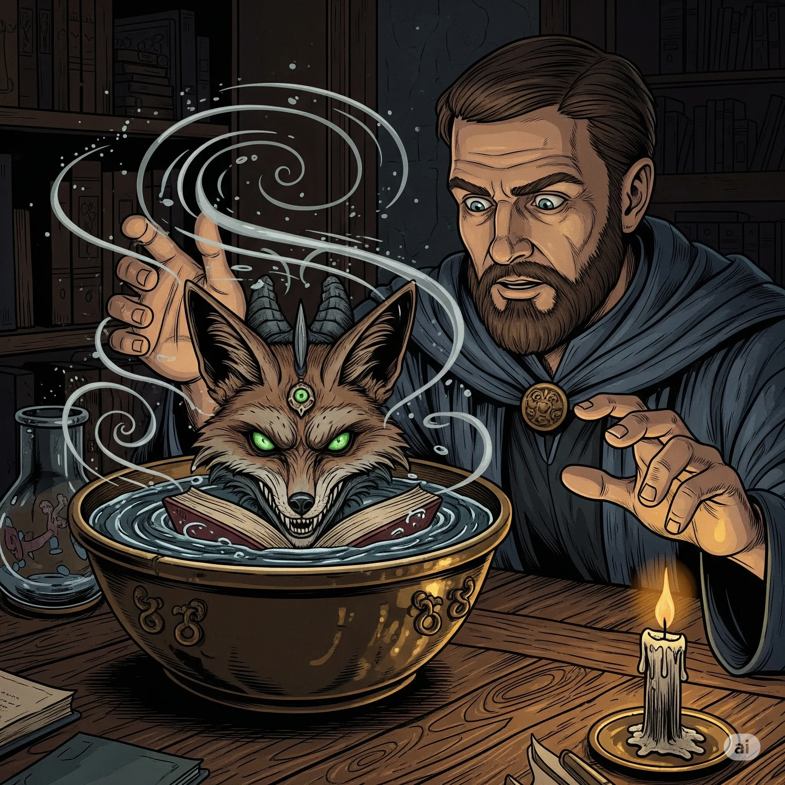

_Tajemnicza istota z innego świata, strażnik prastarych tajemnic, widoczna w mosiężnej misie._

## Opis
Jawi się jako twarz w tafli wody w [[Mosiężna Misa|mosiężnej misie]]. Przedstawia się jako Kustosz prastarych tajemnic.

## Osobowość
Tajemniczy; oferuje wiedzę w zamian za przysługę. Do Felicjana zwrócił się słowami: „Nie lękaj się. Ja nie gryzę."

## Historia
W [[Sesja 53 - Koniec Yonder]] [[Felicjan Janus Twardowski|Felicjan]] zbadał misę znalezioną w Wielkiej Bibliotece. Gdy spojrzał na jej powierzchnię, naczynie wypełniło się wodą, a w niej ukazała się twarz Kustosza. Zaoferował Felicjanowi wiedzę o [[Morze Otchłani|Morzu Otchłani]], która mogłaby ocalić drużynie życie, w zamian za bliżej nieokreśloną przysługę w przyszłości. Felicjan, choć zaintrygowany, odrzucił pakt, obiecując, że „oddzwoni". W kolejnych sesjach Kustosz już się nie pojawia.
