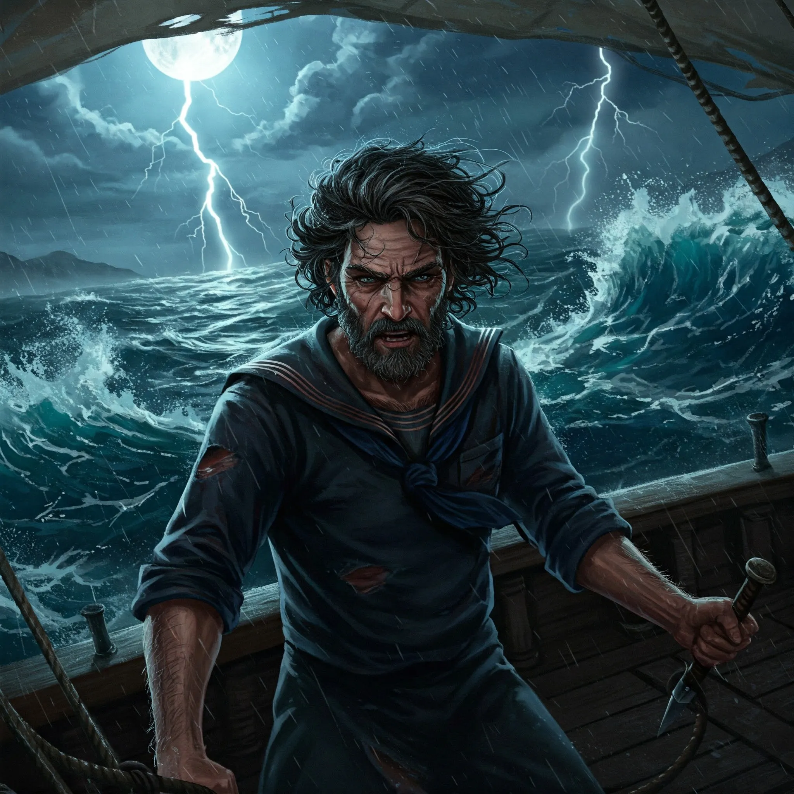

_Sternik poszukujący lekarstwa dla żony_

## Opis
Sternik małego stateczku; jego żona jest chora. Mężczyzna w średnim wieku.

## Osobowość
Zdeterminowany, by uratować swoją chorą żonę. Odważny na tyle, by przemierzać niebezpieczne wody w poszukiwaniu owoców z Drzewa Serca.

## Historia
W [[Sesja 39 - Tajemnice Wyspy Złotego Serca]] na horyzoncie pojawił się jego mały stateczek, a Laios poprosił bohaterów o pomoc w zdobyciu owoców z [[Drzewo Serca|Drzewa Serca]], które miały uzdrowić jego chorą żonę. Drużyna ruszyła potem na [[Wyspa Złotego Serca|Wyspę Złotego Serca]]. Później już się nie pojawia.
