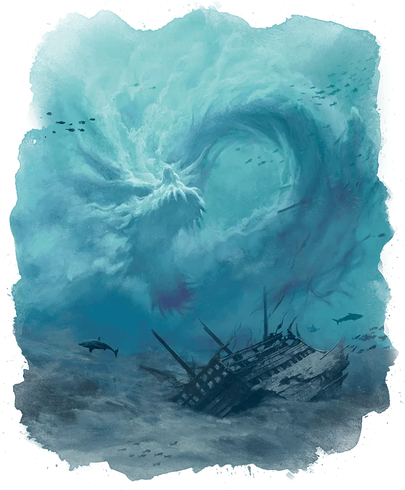

_Gigantyczna morska bestia, która wsparła [[Sydon|Sydona]] w Bitwie o Mytros i zginęła z ręki [[Orestes|Orestesa]]._

## Opis
Potężny potwór morski o kolosalnym cielsku, zdolny wzburzać gigantyczne fale pływowe i oblewać wrogów żrącym kwasem. Uderza masywnym ciałem oraz miażdżącym ogonem.

## Historia
W [[Sesja 80 - Bitwa o Mytros: Śmierć Pana Burz]] [[Orion Xul|Orion]] dostrzegł pod powierzchnią wody gigantyczny cień płynący od strony miasta – to Lewiatan zmierzał do bitwy, by wesprzeć Władcę Burz. Wynurzył się z głębin i wzbudził gigantyczną falę pływową. [[Kolos Pythora]] wbił w niego włócznię, ciężko go raniąc, a [[Felicjan Janus Twardowski|Felicjan]] odwrócił grawitację magicznym zwojem i wyrwał bestię z wody wysoko w powietrze; gdy anomalia wygasła, potwór runął z powrotem w głębię. Wynurzył się ponownie: uderzył w [[Versir|Versira]] cielskiem, oblewając go żrącym kwasem, i poprawił miażdżącym ciosem ogona, a potem runął na [[Orestes|Orestesa]]. Orestes, wpadłszy w szał, dopłynął do niego i serią cięć [[Topór Xandera|Toporem Xandera]] zabił potwora.
