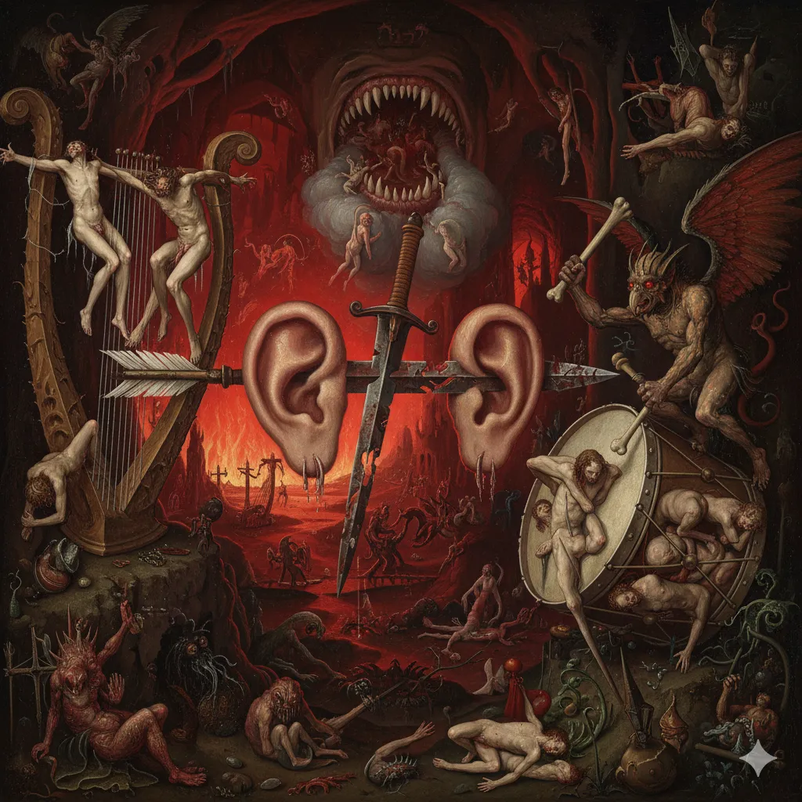

_Dyrygent Orkiestry Dusz, upiór z Typhona pokonany ostatecznie na arenie Wyspy Krzywoprzysięstwa._

## Opis
Postać w obsydianowej zbroi, dosiadająca płonącego koszmara (Nightmare). Walczy lancą ciskającą ogniem, a jego wierzchowiec potrafi przenosić jeźdźców do Planu Eterycznego. Kierował orkiestrą złożoną z dusz potępieńców, uwięzionych jako instrumenty w iluzorycznej katedrze skąpanej w czerwonej poświacie, wewnątrz wulkanu [[Typhon]].

## Historia
W [[Sesja 60 - Typhon Symfonia Potępienia i Brama do Hadesu]] dyrygent zwrócił na bohaterów gniew, gdy [[Orestes]] w akcie brawury spróbował zagrać na swoich dudach. Gdy Orestes pochwycił dyrygenta, jego wierzchowiec przeniósł obu do Planu Eterycznego, gdzie zaatakowali ukrywającego się tam [[Felicjan Janus Twardowski|Felicjana]]. Ostatecznie Orestes strzałą z łuku zrzucił jeźdźca z siodła, a [[Orion Xul|Orion]] przebił włócznią jego hełm i zabił go. Iluzja katedry rozprysła się, a drużyna oskórowała koszmara i zebrała jego kopyta.

W [[Sesja 69 - Ogród Lutherii]] wrócił jako jeden z dawnych wrogów w ostatniej fali areny na [[Wyspa Krzywoprzysięstwa|Wyspie Krzywoprzysięstwa]], tym razem dosiadając miedzianej smoczycy [[Ventis]]. Z jej grzbietu użył *Terrifying Command*, lecz dzięki wcześniej użytemu rogowi bohaterowie nie dali się zastraszyć. Został pokonany razem z Ventis – ostatecznie przez [[Bohaterowie Przepowiedni|Bohaterów Przepowiedni]].
