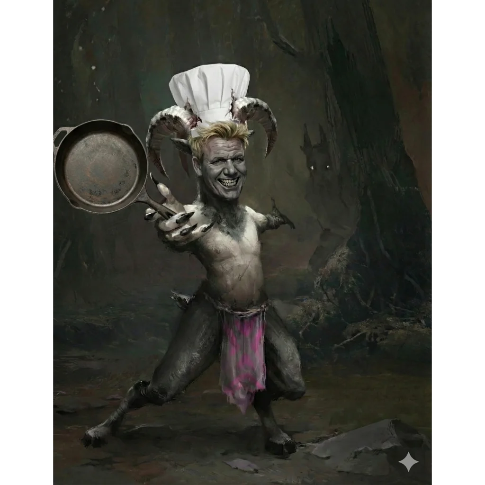

_Szef kuchni w Praxys, który pomógł drużynie i został uwolniony z wieży._

## Opis
Koźlak, główny szef kuchni w wieży [[Praxys]]. Bystry i spostrzegawczy – natychmiast przejrzał przebrania drużyny. Zmęczony despotycznymi rządami Władcy Burz i wizją nadchodzącej, wyniszczającej wojny.

## Historia
Mieszkał i zarządzał kuchnią w wieży [[Praxys]]. W [[Sesja 71 - Infiltracja Praxys]] [[Arevon Elorrenthi|Arevon]] w postaci eterycznej chmury zwiadował pomieszczenia po drodze z odpływu w latrynie i odkrył kuchnię pod batutą koźlaka imieniem Ramsus.

W [[Sesja 72 - Śniadanie u Tytana Bochenek Przeznaczenia]] drużyna wpadła na niego w kuchni wieży. Mimo przebrań bohaterów Ramsus natychmiast przejrzał maskaradę, a próby kłamstw [[Orestes|Orestesa]] spaliły na panewce, lecz nie podniósł alarmu, tylko zaproponował układ. Opowiedział o nadchodzącym śniadaniu [[Sydon|Sydona]] i zaproponował plan "konia trojańskiego": wydrążyć gigantyczny bochenek chleba i ukryć w nim Bohaterów Przepowiedni. Kuchtowie przygotowali chleb, a Orestes wdał się z kucharzem w dyskusję o parowaniu regionalnych piw z daniami. Bohaterowie ukryli się w bochenku, który windą towarową powędrował do prywatnych komnat Tytana.

W [[Sesja 75 - Koniec Przysięgi]] został uwolniony z [[Praxys]] i załadowany na statek razem z innymi uwolnionymi więźniami.
