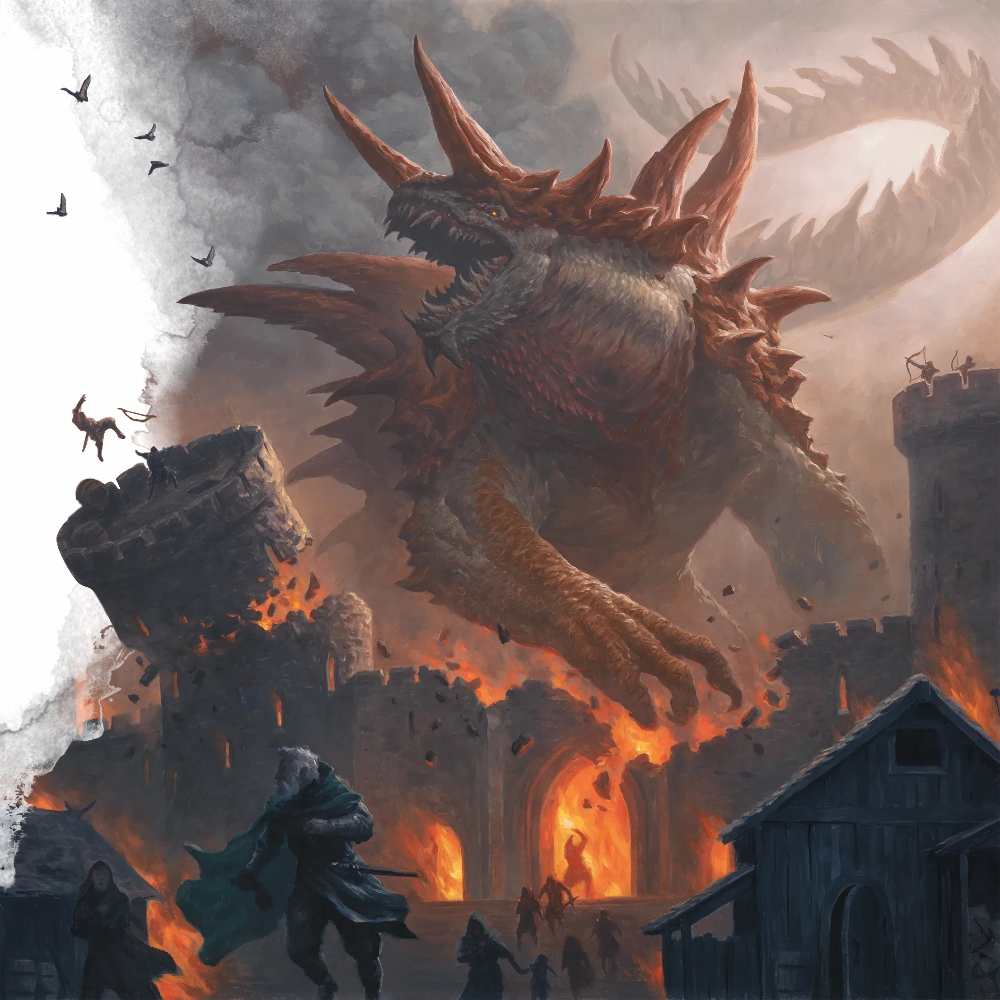

_Legendarny Pożeracz Światów, Zguba Bogów._

## Opis
Tarrasque to istota o niewyobrażalnej potędze i rozmiarach, potwór zdolny do niszczenia całych cywilizacji i panteonów. <!-- UNSOURCED -->

Legendarny Pożeracz Światów. Runy w [[Sześcian Więzienny|Sześcianie Więziennym]] nazywają go "Zgubą Bogów" i głoszą, że jest zrodzony z pustki, by pożreć świat, a przed jego cieniem drżą Tytani. Przebudzony w Sesji 66, spoczywa w gigantycznej komorze pod zbiornikiem z kwasem w Sześcianie; kolejne sesje nie opisują jego uwolnienia, a w [[Sesja 84 - Świt Nowej Ery]] [[Versir]] obiecał doglądać więziennych sześcianów, w których nic się nie zmieniało.

## Historia
W [[Sesja 41 - Wiedźma Lotosu]] bohaterowie ujrzeli śpiącego Tarrasque'a w oknie Korytarza Światów.

W [[Sesja 65 - Wyprawa w Otchłań]] [[Bohaterowie Przepowiedni|Bohaterowie Przepowiedni]] zinfiltrowali [[Sześcian Więzienny|Sześcian Więzienny]] na [[Morze Otchłani|Morzu Otchłani]], w którym Tarrasque spał uwięziony w głównej komorze. [[Versir]] stracił rękę, wkładając ją w czarną Sferę Anihilacji, a [[Arevon Elorrenthi|Arevon]] zajrzał przez ogromną dziurę do głównej komory i odkrył śpiącą bestię; runy mówiły, że to ostateczna broń, "Zguba Bogów".

W [[Sesja 66 - Przebudzenie Bestii i Cienie Otchłani]] Tarrasque został przypadkowo obudzony: [[Felicjan Janus Twardowski|Felicjan]] telekinezą otworzył podłogę i zrzucił do jego leża masę młodych czerwi, a [[Orion Xul|Orion]] uderzył w swą tarczę, wyzwalając falę gromu (*Thunderwave*). Huk i zapach czerwi spadających na pysk bestii wyrwały ją ze snu. Jej przebudzenie zaalarmowało zarządcę więzienia ([[The Keeper|The Keepera]]), który zaproponował drużynie układ, oraz [[Lutheria|Lutherię]], która ruszyła do sześcianu.
