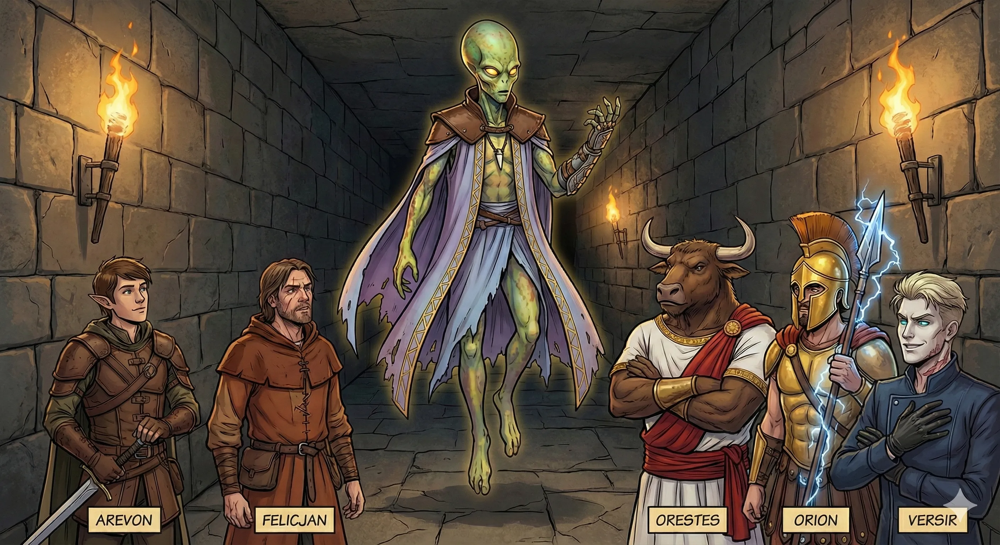

_Znużony i cyniczny urzędnik piekieł, demoniczny zarządca Sześcianu Więziennego na Morzu Otchłani._

## Opis
Ultroloth: lewitująca postać o wydłużonej głowie pozbawionej ust i twarzy, komunikująca się telepatycznie. Jest demonicznym zarządcą [[Sześcian Więzienny|Sześcianu Więziennego]], w którym spoczywa [[Tarrasque]].

W przeciwieństwie do fanatycznych sług Tytanów bardziej interesuje go spokój i porządek niż lojalność. Ubrany w szaty. <!-- UNSOURCED -->

## Osobowość
*   **Cyniczny:** Traktuje swoją rolę jako pracę, a nie powołanie.
*   **Pragmatyczny:** Gotów zawrzeć układ z wrogami swojej pani, jeśli przyniesie mu to korzyść lub rozwiąże problem.
*   **Znużony:** Sprawia wrażenie zmęczonego wieczną służbą.

## Historia
W [[Sesja 66 - Przebudzenie Bestii i Cienie Otchłani]] został wyrwany z rutyny, gdy hałas w sześcianie i przebudzenie [[Tarrasque|Tarrasque'a]] zbudziły więzienie. Wraz z trzema brązowymi automatonami wyłonił się z cienia przed bohaterami, lecz zamiast ich zaatakować, poinformował, że [[Lutheria]], Pani Snów, jest już w drodze, zaalarmowana hałasem. Zaproponował układ: jeśli bohaterowie w przyszłości dostarczą mu Kosę Lutherii, pomoże im w ostatecznym rozwiązaniu problemu uwolnionego Tarrasque'a. Gdy drużyna uciekała, [[Felicjan Janus Twardowski|Felicjan]] zostawił na schodach magiczne oko i zobaczył, jak The Keeper opuszcza sześcian i wita się z nowo przybyłą postacią.

Pani Snów zginęła w [[Sesja 82 - Bitwa o Mytros: Śmierć Pani Snów]], a jej [[Kryształowa Kosa Lutherii|Kryształowa Kosa]] została rozbita przez [[Orestes|Orestesa]] w [[Sesja 84 - Świt Nowej Ery]]. W tej samej sesji [[Versir]] obiecał doglądać więziennych sześcianów, w których nic się nie zmieniało.
