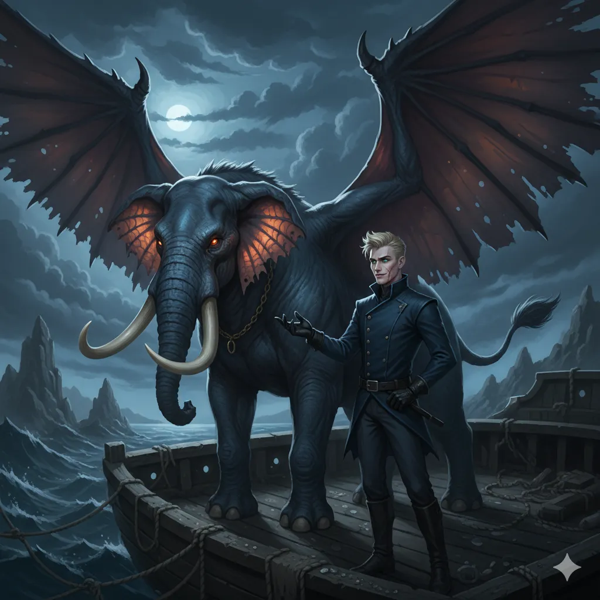

_Magiczny, skrzydlaty słoń (hefalump) – niebiański wierzchowiec [[Versir|Versira]]._

## Opis
Wygląda jak słoń ze skrzydłami. Związana z Versirem mistyczną więzią; w czasie ostatniej bitwy przyzywana przez niego wciąż na nowo.

## Historia
W [[Sesja 62 - Arezyjska Dyplomacja]] [[Versir]] przyzwał ją, aby dodać drużynie splendoru podczas wpływania do [[Arezja|Arezji]].

W [[Sesja 68 - Arena Krzywoprzysięstwa]] Versir latał na swojej magicznej Trąbie i dzięki temu unikał wiru Fekaliusza.

W [[Sesja 79 - Bitwa o Mytros: Gniew Pana Burz]] tkwiła spętana wirami powietrza. Versir wyleczył siebie i ją czarem *Leczenie Ran (Cure Wounds)*, po czym teleportował się z nią przed oblicze [[Sydon|Sydona]].

W [[Sesja 80 - Bitwa o Mytros: Śmierć Pana Burz]] niosła Versira w ostatecznym starciu z Sydonem nad wodami zatoki. Żrący deszcz z burzy Sydona dosięgnął ją najboleśniej, więc Versir rozwiał więź z wierzchowcem i spadł na pokład [[Tranquility]]. Przyzwał ją na nowo w niebiańskiej, promiennej postaci, ale wyładowania z burzy Sydona uśmierciły również ją. Versir przyzwał wtedy trzecią inkarnację Trąby i na jej grzbiecie zaszarżował na Sydona po falach. W kolejnych sesjach Trąba już się nie pojawia.
