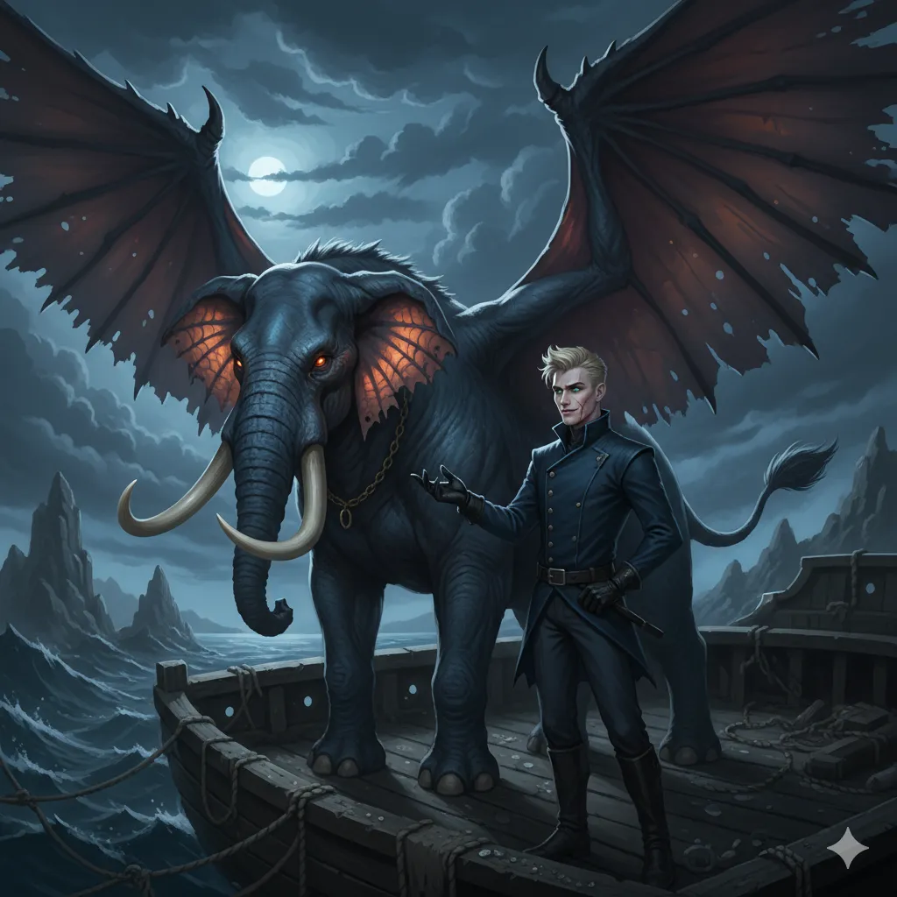

_Magiczny, skrzydlaty słoń (hefalump) – niebiański wierzchowiec [[Versir|Versira]]._

## Opis
Wygląda jak słoń ze skrzydłami. Związany z Versirem mistyczną więzią; w czasie ostatniej bitwy przyzywany przez niego wciąż na nowo.

## Historia
W [[Sesja 62 - Arezyjska Dyplomacja]] [[Versir]] przyzwał go, aby dodać drużynie splendoru podczas wpływania do [[Arezja|Arezji]].

W [[Sesja 68 - Arena Krzywoprzysięstwa]] Versir latał na swoim magicznym Trąbie i dzięki temu unikał wiru Fekaliusza.

W [[Sesja 79 - Bitwa o Mytros: Gniew Pana Burz]] tkwił spętany wirami powietrza. Versir wyleczył siebie i jego czarem *Leczenie Ran (Cure Wounds)*, po czym teleportował się z nim przed oblicze [[Sydon|Sydona]].

W [[Sesja 80 - Bitwa o Mytros: Śmierć Pana Burz]] niósł Versira w ostatecznym starciu z Sydonem nad wodami zatoki. Żrący deszcz z burzy Sydona dosięgnął go najboleśniej, więc Versir rozwiał więź z wierzchowcem i spadł na pokład [[Tranquility]]. Przyzwał go na nowo w niebiańskiej, promiennej postaci, ale wyładowania z burzy Sydona uśmierciły również jego. Versir przyzwał wtedy trzecią inkarnację Trąby i na jego grzbiecie zaszarżował na Sydona po falach.

W [[Sesja 86 - Trzy Klucze Teogenezy]] [[Versir]] przyzwał go za bramą [[Arezja|Arezji]] i poleciał na nim z drużyną na północ. W [[Bór Thrake|Borze Thrake]] został z bohaterami na ziemi; Versir wskoczył na jego grzbiet i teleportował się z nim na bezpieczną odległość od szarżujących minotaurów.

W [[Sesja 88 - Krwawe Schody Fortu]] próbował osłonić nieprzytomnego [[Versir|Versira]] na schodach [[Fort Zakrotha|Fortu Zakrotha]] i zginął od zatrutej piki [[Murgrat|Murgrata]]. Po walce Versir przyzwał go na nowo.
