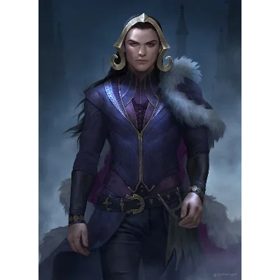

_Kapłan Śmierci i winiarz, pokonany przez bohaterów w Świątyni Lutherii._

## Opis
Trellus to Kapłan Śmierci, kapłan **[[Lutheria|Lutherii]]**, pokonany przez bohaterów w [[Sesja 16 - Świątynia Lutherii]] i ponownie na arenie w [[Sesja 68 - Arena Krzywoprzysięstwa]].

Fanatyczny arcykapłan, który oficjalnie zarządza winnicami kultu. Jest bratem i kochankiem **[[Septia|Septii]]**.

## Działalność
Razem z siostrą organizował porwania i rytualne ofiary z ludzi w podziemiach **[[Świątynia Lutherii|świątyni]]**.

## Historia
W [[Sesja 16 - Świątynia Lutherii]] drużyna dotarła przez [[Kanały Mytros|kanały]] do głównej sali [[Świątynia Lutherii|Świątyni Lutherii]], gdzie stoczyła walkę z chimerą, [[Septia|Septią]] (Kapłanką Snów), Trellusem (Kapłanem Śmierci) i wieloma [[Kult Lutherii|kultystami Lutherii]]. Bohaterowie pokonali wszystkich i uratowali grupę więzionych tam dzieci.

W [[Sesja 68 - Arena Krzywoprzysięstwa]] wrócił na arenę [[Wyspa Krzywoprzysięstwa|Wyspy Krzywoprzysięstwa]] jako jeden z dawnych wrogów Bohaterów Przepowiedni, walcząc w czwartej fali. [[Versir]] zaklęciem *Vortex Warp* teleportował go razem z Maximusem w ścianę ognia [[Felicjan Janus Twardowski|Felicjana]].
