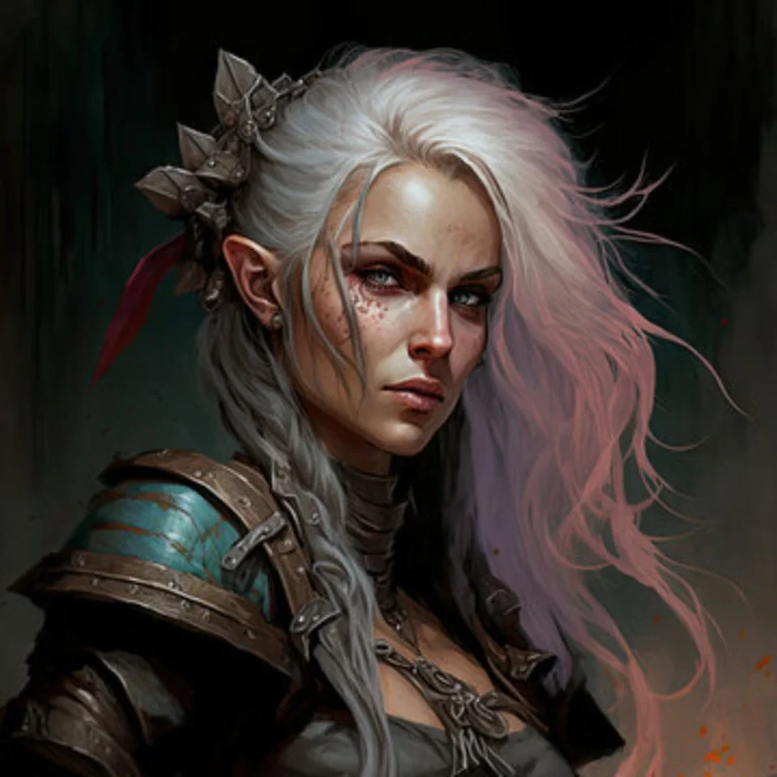

_Złodziejka i członkini Kultu Węża; po rewolucji na Themis wyszła z pałacu u boku Amazonek._

## Opis
Greciosa to siostra **[[Nera]]**. Często przesiaduje w **[[Satyrzy Ogon]]**, świętując udane kradzieże. Jest członkinią **[[Kult Węża|Kultu Węża]]** i szpiegiem.

Widziano ją również na wydarzeniu u **[[Maximus|Maximusa]]** w [[Sesja 19 - Pojedynek z Rozpruwaczem]].

Sugeruje to, że szpiegowała dla Kultu.

## Historia
W [[Sesja 21 - Ukryte pragnienia Ismene]] przebywała w tawernie [[Satyrzy Ogon]], po czym wraz z siostrą [[Nera|Nerą]] śledziła drużynę. Obie zostały złapane na statku [[Varkon|Varkona]] i przesłuchane; Greciosa oskarżyła [[Versir|Versira]] o zdradę.

Podczas przesłuchania ujawniła też, że [[Moxena]] jest Meduzą.

W [[Sesja 22 - Taniec z Meduzą]] drużyna odprowadziła ją i Nerę do [[Vallus]], która obiecała przetrzymać je z dala od króla [[Acastus|Acastusa]].

W [[Sesja 31 - Wyprawa na Themis]] dołączyła do załogi przed wyprawą na Themis (wraz z [[Moxena|Moxeną]] i [[Rhea|Rheą]]).

W [[Sesja 36 - Królowa, Dziedzic i Generał]] wyszła z pałacu na Themis razem z [[Hippolyta|Hippolytą]], [[Darien]], [[Rhea|Rheą]] i [[Focabe]] po rewolucji.
