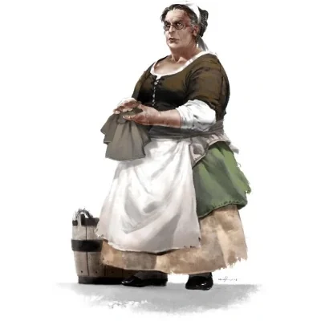

_Gospodyni gospody [[Kwaśny Rocznik]] i emerytowana łowczyni._

## Opis
Aetala jest silną, dojrzałą kobietą, która emanuje spokojem i profesjonalizmem weteranki. Choć teraz zajmuje się prowadzeniem gospody, jej ruchy wciąż zdradzają sprawność dawnej łowczyni.

## Osobowość
Jest praktyczna i dobrze poinformowana. Zna [[Kontynent Thylea|Heartlandy]] lepiej niż ktokolwiek inny i zawsze ma świeże wieści z [[Estoria|Estorii]]. Wspiera bohaterów, wierząc, że są w stanie sprostać wyzwaniom, o których inni tylko marzą.

## Historia
Aetala dorobiła się fortuny dziesiątki lat temu, upolowawszy bestię podobną do Wielkiego Dzika. To doświadczenie czyni ją cennym sojusznikiem i źródłem informacji. 

Współpracuje z [[Kyrah]], udostępniając swoją gospodę jako bezpieczne miejsce spotkań dla Bohaterów Przepowiedni (zobacz: [[Sesja 1 - Wielki Dzik]]).
