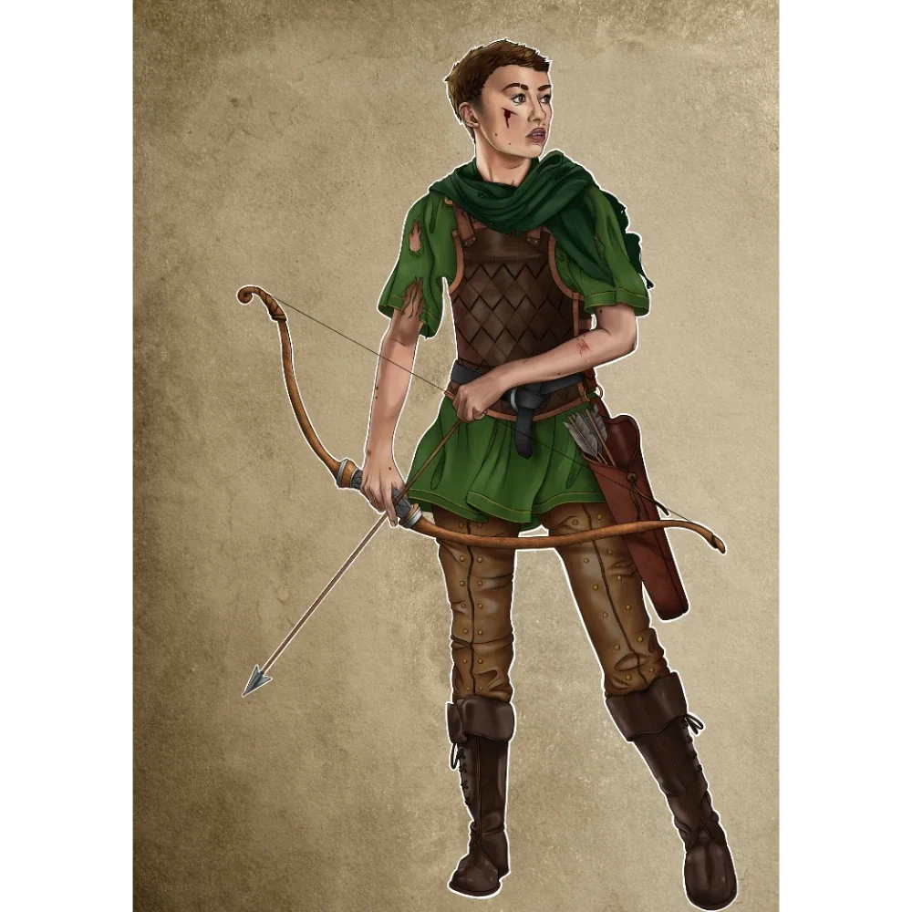

_Myśliwy zatrudniony przez [[Kyrah]] do polowania na [[Wielki Dzik|Wielkiego Dzika]]._

## Opis
Javon jest zahartowanym przez naturę zwiadowcą o opalonej słońcem skórze. Nosi praktyczną skórzaną zbroję i zawsze ma przy sobie długi łuk.

## Osobowość
Myśliwy-zwiadowca wynajęty przez [[Kyrah]], który prowadził drużynę na polowaniu na dzika.

## Historia
W [[Sesja 1 - Wielki Dzik]] został zatrudniony przez [[Kyrah]] wraz z drugim myśliwym, [[Taneias|Taneiasem]]. Obaj dołączyli do bohaterów na godzinę przed świtem i po wielu godzinach poszukiwań grupa dotarła do jaskini, w której przebywał dzik. Po krótkiej walce dzik został zabity.
