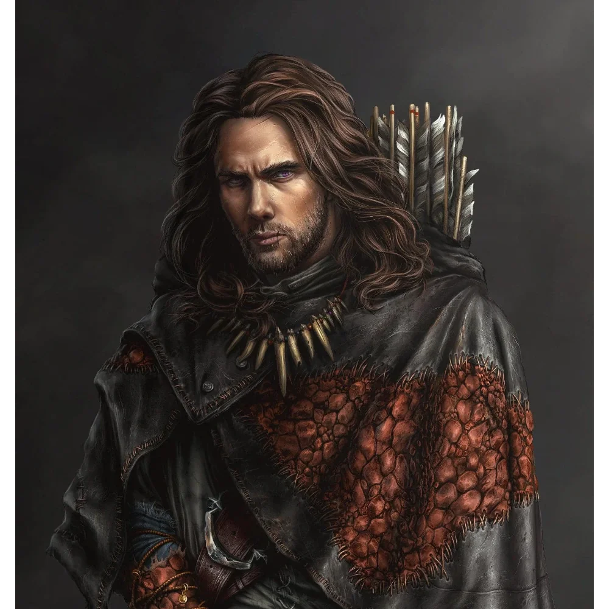

_Doświadczony myśliwy i zwiadowca zatrudniony przez [[Kyrah]]._

## Opis
Taneias jest zahartowanym przez naturę zwiadowcą o opalonej słońcem skórze. Nosi praktyczną skórzaną zbroję i zawsze ma przy sobie długi łuk.

## Osobowość
Jest myśliwym i tropicielem, który poprowadził bohaterów do legowiska dzika.

## Historia
W [[Sesja 1 - Wielki Dzik]] [[Kyrah]] zatrudniła go wraz z [[Javon|Javonem]] jako myśliwego do pomocy [[Bohaterowie Przepowiedni|Bohaterom Przepowiedni]]. Obaj dołączyli do drużyny następnego dnia na godzinę przed świtem. Po wielu godzinach poszukiwań bohaterowie dotarli do jaskini [[Wielki Dzik|Wielkiego Dzika]] i zabili bestię. Taneias nie pojawia się w dalszych sesjach.
