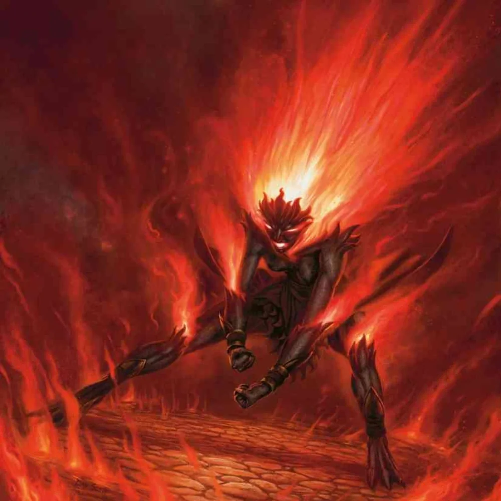

Żywiołak ognia, który był uwięziony w Mithralowej Kuźni, uwolniony przez bohaterów w zamian za rok służby.

## Opis
Salamandra żyjąca w basenie lawy. Przez wieki zasilała płomienie kuźni, a w czasie Pierwszej Wojny pomagała Volkanowi wytwarzać przedmioty z mithrilu i adamantu.

## Osobowość
Nienawidzi krasnoludów za swoje uwięzienie. Jest dumna ze swoich umiejętności kowalskich. Pragnie wolności za wszelką cenę.

## Historia
Została przyzwana przez krasnoludy wieki temu, by zasilać i obsługiwać Mithralową Kuźnię. Związana magicznym kontraktem, nie mogła opuścić tego miejsca.

W [[Sesja 11 - Mithralowa Kuźnia]] drużyna dotarła do [[Mithralowa Kuźnia|mithralowej kuźni]] i spotkała uwięzionego żywiołaka ognia, The Forge Keeper. Żywiołak zgodził się służyć bohaterom przez rok w zamian za uwolnienie, i bohaterowie ją uwolnili. Chwilę później usłyszeli ciężkie kroki zbliżającego się [[Pythor|Pythora]]. W [[Sesja 13 - Wezwani przez Króla]] jest jeszcze wymieniona wśród NPC.
