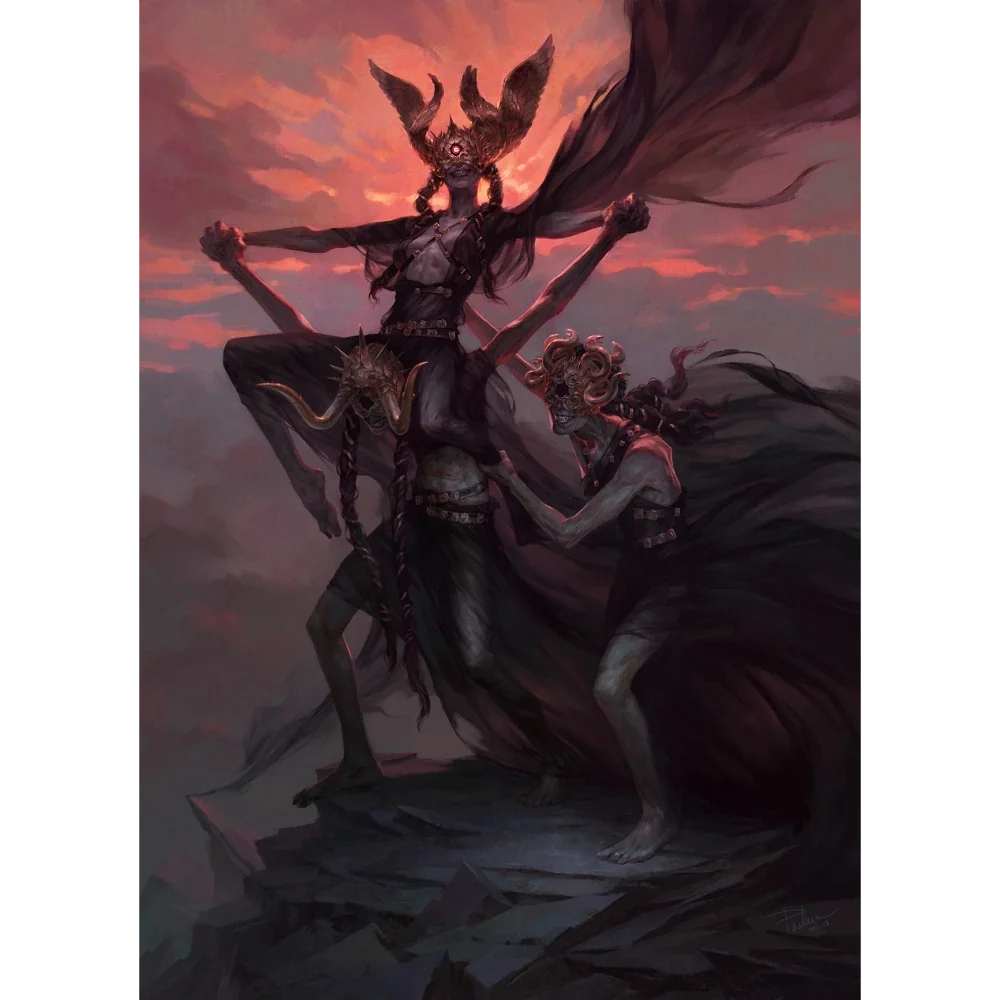

_Jedna z trzech [[Mojry|Mojr]], odmierzająca nić losu._

## Opis
Decima to potężnie zbudowana kobieta o skórze twardej jak granit, z pustym oczodołem, koroną wijących się, metalicznych węży na głowie i metalicznymi zębami.

## Osobowość
Jest obowiązkowa i wierna [[Morta|Morcie]], ale też lubi flirtować z gośćmi, choć jej zaloty są podszyte groźbą. Jest złośliwa w swoich uwagach, wytykając bohaterom ich błędy i lęki.

## Historia
W [[Sesja 47 - Wyspa Mojr]] wraz z [[Morta|Mortą]] i [[Nona|Noną]] powitała drużynę szyderczym śmiechem. Drwiła z [[Arevon Elorrenthi|Arevona]], pytając, kiedy poszukiwania zaginionej załogi stały się dla niego drugorzędne, oraz z [[Orestes|Orestesa]], wypominając mu bierność podczas igrzysk. W [[Sesja 48 - Pakty z Mojrami i Zew Chimery|Sesji 48]] jest jeszcze wymieniona wśród Mojr.
