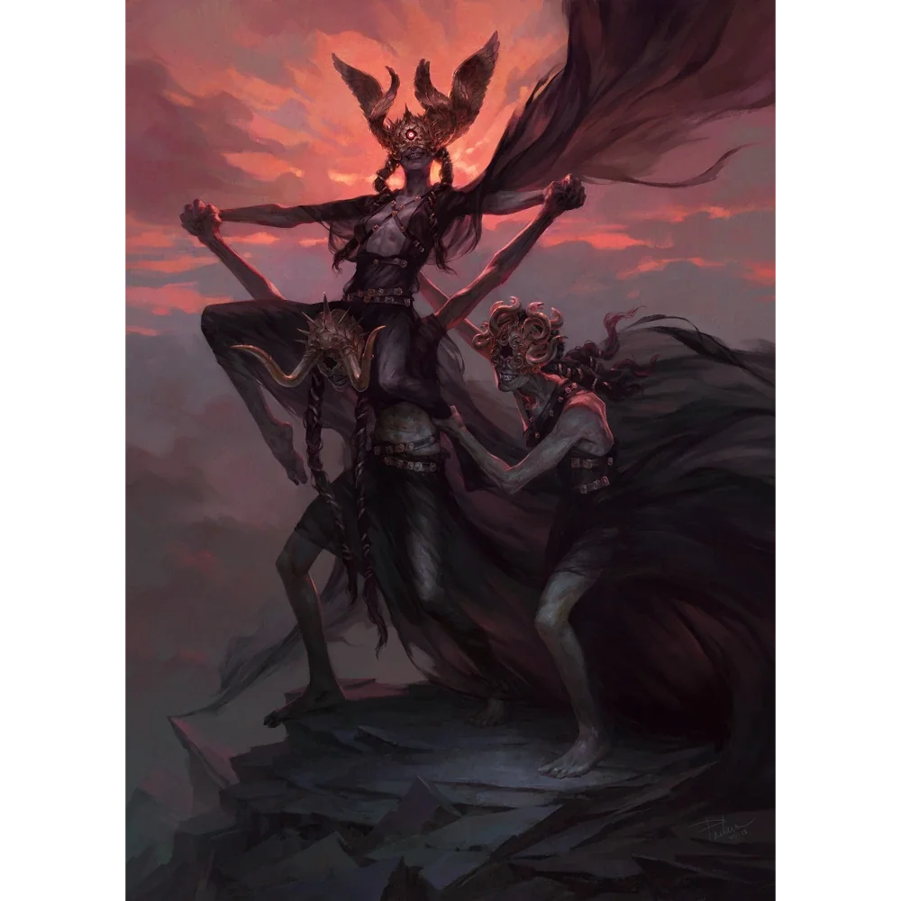

_Liderka Mojr, najstarsza z trzech sióstr._

## Opis
Morta to najstarsza i najbardziej złowroga z trzech sióstr; bohaterowie nazywali ją babuszką. Wygląda jak stara wiedźma z pustym oczodołem i roztacza słodkawy odór rozkładu. W [[Sesja 47 - Wyspa Mojr]] mieszała w ogromnym kotle, a jej obnażone piersi dyndały, gdy chichotała szyderczo.

Często trzyma zardzewiałe nożyce, którymi przecina nici losu na Krośnie Mojr.

## Osobowość
W [[Sesja 47 - Wyspa Mojr]] zadrwiła z wiary bohaterów w powstrzymanie Bliźniaków, a potem przerwała igraszki sióstr, żądając, by wyjawili cel wizyty.

Jest rubaszna i uwielbia drwić ze śmiertelników. Jako liderka kowenu podejmuje ostateczne decyzje.

## Historia
Morta wraz z siostrami zamieszkuje [[Wyspa Mojr]] od tysiącleci i zawiera mroczne układy z potężnymi istotami, m.in. z [[Lutheria|Lutherią]].

W [[Sesja 47 - Wyspa Mojr]] wraz z [[Decima|Decimą]] i [[Nona|Noną]] przyjęła Bohaterów Przepowiedni. Mojry przyznały, że [[Sydon]] zapłacił im za rzucenie klątwy na smocze jaja, ale umowa nie obejmowała jej utrzymania. W negocjacjach o cenę za jej zdjęcie Morta zapytała [[Orestes|Orestesa]], czy wyrzekłby się piwa na zawsze.

W [[Sesja 48 - Pakty z Mojrami i Zew Chimery]] opowiedziała [[Felicjan Janus Twardowski|Felicjanowi]] o jego prababce [[Despina|Despinie]]: że była siostrą [[Adonis Neurdagon|Adonisa Neurdagona]], przybyła do Thylei ze Smoczymi Lordami, lecz zdradziła ich ideały, zażądała od Sydona uczynienia jej królową, została przez niego wygnana i skazana na śmierć, a w końcu dosięgła ją ręka [[Talieus|Talieusa]]. Następnie ujęła Kostur Sydona i różdżkę Felicjana, skupiła starożytną moc i obróciła oba artefakty w pył, zdejmując klątwę ze smoczych jaj.
