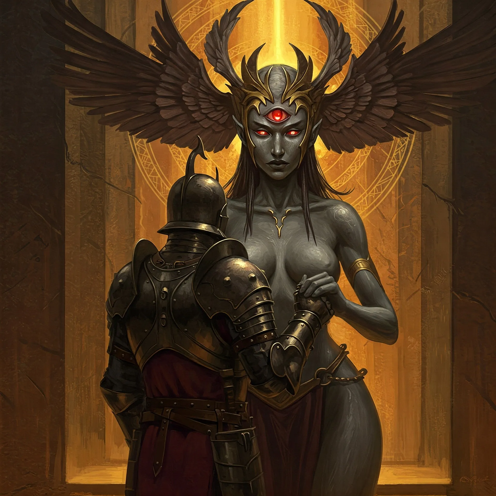

_Jedna z trzech Mojr, odpowiedzialna za dodawanie nowych nici do krosna losu._

## Opis
W [[Sesja 47 - Wyspa Mojr]] Nona jest młodo wyglądającą kobietą z jednym świetlistym okiem pośrodku czoła i nakryciem głowy przypominającym ciemne, trzepoczące skrzydła. Pracuje przy Krośnie, karmiąc je sznurami ścięgien i wnętrzności. W [[Sesja 48 - Pakty z Mojrami i Zew Chimery]] opisana jest jako ta o młodzieńczym obliczu i pojedynczym, świdrującym oku.

Jej młody wygląd to tylko pozór, bo natura wiedźmy jest potworna. <!-- UNSOURCED -->

## Osobowość
Jest lubieżna i uwodzicielska w makabryczny sposób, co pokazała wobec [[Orion Xul|Oriona]] i [[Felicjan Janus Twardowski|Felicjana]].

Jest wściekła, pełna urazy i wiecznie głodna. Patrzy na gości jak na posiłek, śliniąc się na myśl o ich smaku. <!-- UNSOURCED -->

## Historia
W [[Sesja 47 - Wyspa Mojr]] Nona podeszła do [[Orion Xul|Oriona]], wzięła jego dłoń, komplementując jego urodę i odwagę, po czym zmysłowo ją oblizała. Zaproponowała mu wzmocnienie jego włóczni w zamian za spędzenie z nią nocy i spłodzenie dziecka.

W [[Sesja 48 - Pakty z Mojrami i Zew Chimery]] Orion zgodził się na intymny pakt z Noną w zamian za wzmocnienie włóczni. Gdy [[Felicjan Janus Twardowski|Felicjan]] przypieczętował własny pakt z Mojrami, Nona ujęła jego dłoń i z niepokojącym uśmiechem oblizała ją. Obiecała też [[Orestes|Orestesowi]], nazywając go byczkiem, że jeszcze odwiedzi go w snach. Na koniec to ona wyprowadziła drużynę z jaskiń Mojr z powrotem na powierzchnię wyspy.
