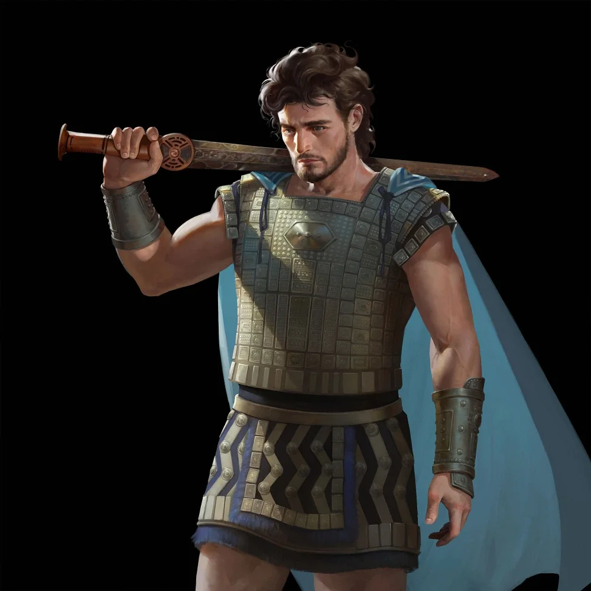

_Smoczy Lord Acastusa_

## Opis
Członek nowo formowanego przez króla Acastusa zakonu "Smoczych Lordów". Dosiada miedzianego smoka [[Aithon|Aithona]].

## Historia
Należy do frakcji Smoczych Lordów Acastusa, grupy lojalnej królowi Mytros, która ma na celu przywrócenie potęgi dawnych jeźdźców smoków, choć nie są oni częścią oryginalnego zakonu.

## Po wojnie
Przeszedł z Aithonem do [[Zakon Smoczych Lordów|Zakonu Smoczych Lordów]] [[Felicjan Janus Twardowski|Felicjana]] i należy do jego rdzenia. Acastusa, który kiedyś go oszukał, spotyka dziś w Zakonie jako dyplomatę; w Zakonie był przed nim.
