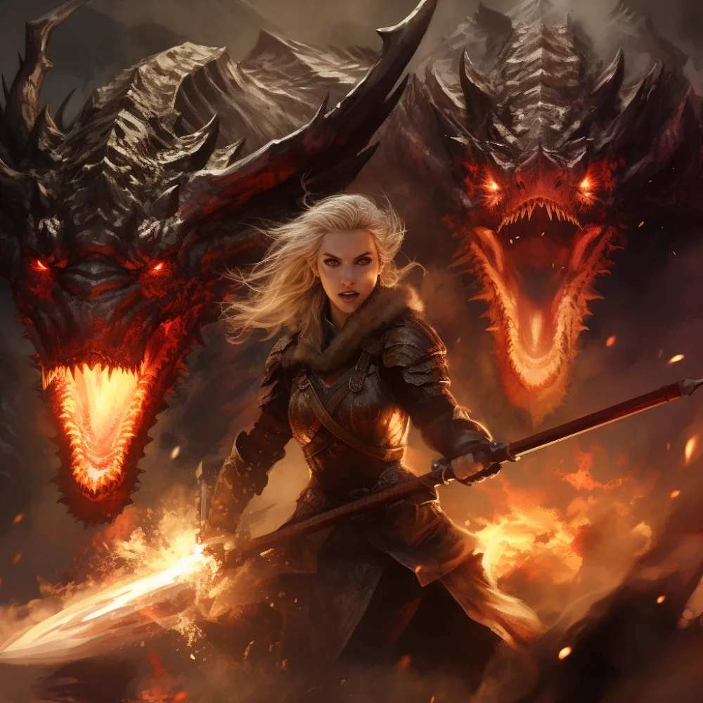

_Smoczy Lord Acastusa_

## Opis
Członkini nowo formowanego przez króla Acastusa zakonu „Smoczych Lordów”.

Dosiada miedzianej smoczycy [[Erythra|Erythry]] ([[Sesja 76 - Bitwa o Mytros: Pierwsza Fala]]).

## Historia
Należy do frakcji [[Smoczy Lordowie|Smoczych Lordów]] Acastusa, grupy lojalnej królowi Mytros, która ma na celu przywrócenie potęgi dawnych jeźdźców smoków, choć nie są oni częścią oryginalnego zakonu.

W [[Sesja 20 - Noc Długich Rogów]] spotkała drużynę nad rzeką, prowadząc śledztwo w sprawie zamieszek, którego zbadanie powierzył jej król [[Acastus]].

W [[Sesja 76 - Bitwa o Mytros: Pierwsza Fala]] na miedzianym smoku uratowała w locie spadającego [[Acastus|Acastusa]].

W [[Sesja 81 - Bitwa o Mytros: Koszmar na Targu Minotaurów]] otrzymała nowe wytyczne w trakcie reorganizacji dowództwa.

## Po wojnie
Przeszła z Erythrą do [[Zakon Smoczych Lordów|Zakonu Smoczych Lordów]] [[Felicjan Janus Twardowski|Felicjana]] i należy do jego rdzenia. Acastusa, który kiedyś ją oszukał, spotyka dziś w Zakonie jako dyplomatę; w Zakonie była przed nim.
