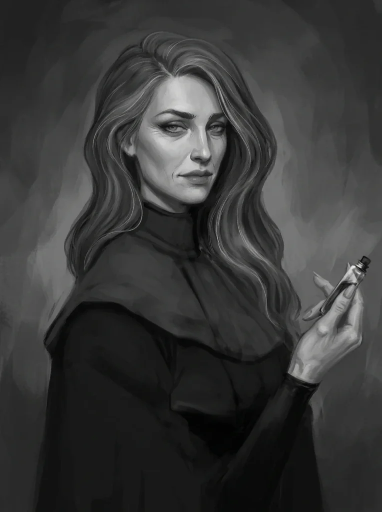

_Członkini Kultu Węża, sojuszniczka i towarzyszka życia Versira._

## Opis

Astra to członkini **[[Kult Węża|Kultu Węża]]**, która początkowo była nieufna wobec **[[Versir|Versira]]**, gdy ten dołączył do organizacji. Ich relacja zmieniła się w sojusz i przyjaźń po wydarzeniach na cmentarzu, gdzie Astra odwiedzała grób swojego brata.

Żyje szczęśliwie z Versirem od kilku lat, ale to ona się starzeje, a półtytan nie. Mimo to wybrała drogę z nim: kocha go i trzyma się blisko niego ([[Sesja 84 - Świt Nowej Ery]]).

## Historia

Jej brat został złożony w ofierze Tytanom (**[[Sydon]]** i **[[Lutheria]]**), co napełniło ją głęboką nienawiścią do nich. Gdy Versir wyjawił jej swoją prawdziwą naturę i cel zemsty nad grobem jej brata, przysięgła mu wierność w walce z Tytanami.

W [[Sesja 19 - Pojedynek z Rozpruwaczem]] [[Versir]] rozglądał się za nią.

W [[Sesja 21 - Ukryte pragnienia Ismene]] przyszła do [[Versir|Versira]] w kapturze, informując go, że [[Moxena]] zawarła potajemny układ ze smoczycą [[Hexia|Hexią]]. Astra doniosła, że Moxena porywa i sprzedaje Hexii skamieniałych artystów, wykorzystując do tego półorka [[Varkon|Varkona]] i magiczkę [[Rhea|Rheę]].

W [[Sesja 22 - Taniec z Meduzą]] [[Versir]] chciał ją uwolnić.

W [[Sesja 24 - Ultros]], podczas walki na widmowym statku [[Ultros]], została zabita przez [[Estor Arkelander|Estora]] Arkelandera, który skupił się na niej i na [[Arevon Elorrenthi|Arevonie]]. Gdy sytuacja stała się rozpaczliwa, wkroczyła bogini [[Kyrah]], a rozdarte przez nią jasne światło przywróciło Astrę do życia i wyleczyło rany wszystkich obecnych; Kyrah poświęciła na to część swojej boskiej mocy.

W [[Sesja 30 - Zakończenie Igrzysk]] zatańczyła z Versirem na uczcie u Tarana.

W [[Sesja 31 - Wyprawa na Themis]] dołączyła do załogi drużyny przed wyprawą na Themis i wraz z [[Moxena|Moxeną]] wyruszyła na poszukiwanie kontaktu do ruchu oporu w Port Aella.

W [[Sesja 42 - Plemię Węgorza]] udzieliła bohaterom informacji o plemionach Wyspy Indygo.

W [[Sesja 47 - Wyspa Mojr]] dołączyła do drużyny desantowej na [[Wyspa Mojr|Wyspę Mojr]].

W [[Sesja 51 - Desant na Yonder]] przebywała na [[Ultros|Ultrosie]]; [[Felicjan Janus Twardowski|Felicjan]] skontaktował się z nią magicznie i ostrzegł przed [[Gaius|Gaiusem]].

W [[Sesja 54 - Wyznanie Chondrusa]] podeszła z troską do Versira i przypomniała mu o ciężarze, który na nim spoczywa.

W [[Sesja 58 - Wyspa Czasu]] pojawiła się w wizji Versira z teleskopu.

W [[Sesja 59 - Koniec Imprezy]] towarzyszyła bohaterom wznoszącym się ku latającej fortecy.

W [[Sesja 84 - Świt Nowej Ery]] po kilku latach wspólnego, szczęśliwego życia z [[Versir|Versirem]] wyszło na jaw to, czego żadne z nich nie przewidziało: Astra się starzeje, a półtytan nie. [[Arevon Elorrenthi|Arevon]] skomentował to ze smutną znajomością rzeczy — to problem, z którym elfy zmagają się od tysiącleci, ilekroć zwiążą się z ludźmi — i przyznał, że ma w swoich zbiorach eliksir młodości o potencjalnych skutkach ubocznych.

## Po wojnie

Versir powiedział jej wprost, że chciałby, by dzieliła z nim życie w drodze, ale nie będzie jej zatrzymywał, jeśli wybierze spokojny dom. Astra wybrała drogę z nim. Kocha go i trzyma się blisko niego, choć z każdym rokiem widać po niej upływ czasu.
