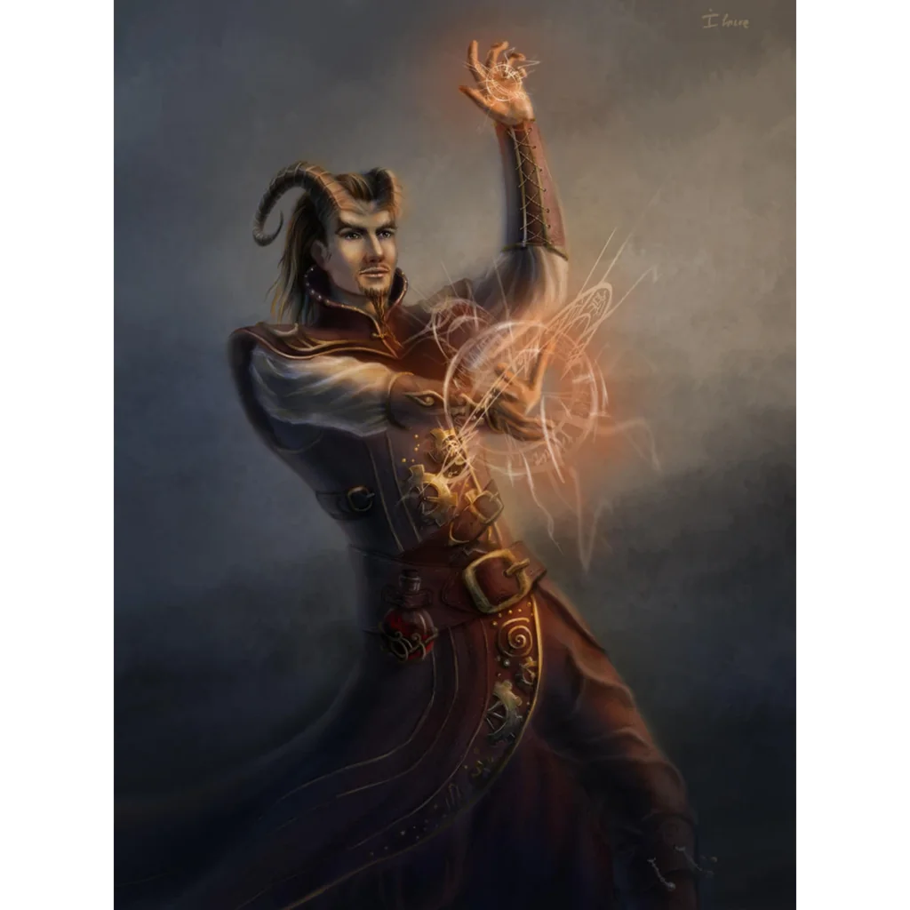

_Filozof i kapitan, autor "Metaphysika Atreusa"._

## Opis
Atreus to tiefling i były kapitan, który poświęcił się filozofii. Jego rozważania dotyczą natury dobra i zła (czy zło jest właściwością, którą można przenieść?), lubi prowokować do myślenia o moralności.
