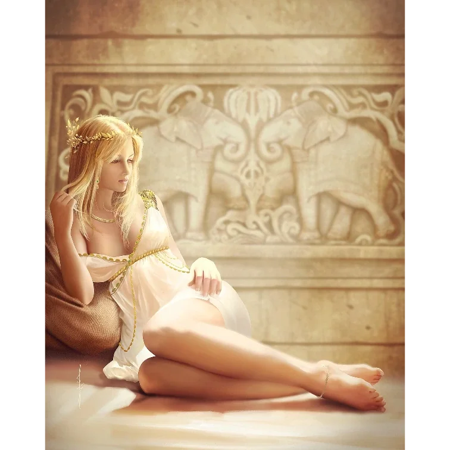

_Konkubina króla Acastusa_

## Opis
Bardzo skąpo ubrana, piękna młoda kobieta.

Jak zwykle ubrana trochę zbyt lubieżnie ([[Sesja 25 - Inauguracja Wielkich Igrzysk]]).

## Historia
Widziana w sali tronowej w towarzystwie króla [[Acastus|Acastusa]] i dowódcy [[Gaius|Gaiusa]]. Sugerowała złożenie drogich ofiar, aby udobruchać Sydona.

W [[Sesja 13 - Wezwani przez Króla]] wraz z Acastusem i Gaiusem chciała zrzucić na bohaterów winę za klęski.

W [[Sesja 55 - Egida Mytros]] wymieniona jest jako konkubina króla Acastusa.
