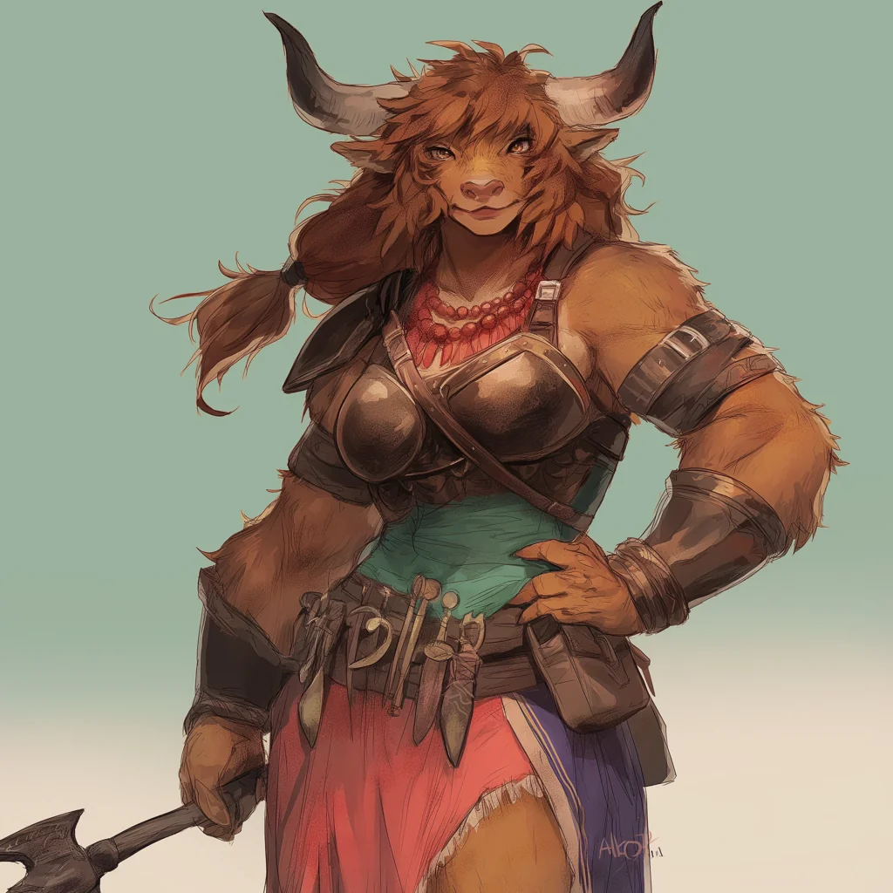

_Heroiczna minotaurzyca._

## Opis
Bullbug to potężna minotaurzyca, uratowana przez drużynę z rąk handlarzy niewolników w Mytros ([[Sesja 63 - Werdykt Arezji]]). W przeciwieństwie do reputacji minotaurów nie jest zła ani żądna krwi.

Została wychowana przez ludzką rodzinę, która traktowała ją jak córkę. Jej rodzina została zabita przez [[Zakon Sydona]], a ona sprzedana w niewolę [[Maximus|Maximusowi]], który z kolei wystawił ją na sprzedaż na **[[Targ Minotaurów|Targu Minotaurów]]**.

W końcowych sesjach przebywa w Arezji, w [[Świątynia Żywiołów|Świątyni Żywiołów]], przy boku [[Taureus|Taureusa]].

## Historia
W [[Sesja 17 - Targ Minotaurów]] [[Orestes]] walczył z nią na arenie na prośbę [[Nephele]] i wygrał, ale odmówił jej zabicia. Drużyna odkupiła Bullbug i zwolniła ją z przysięgi, a ona zapragnęła pomóc bohaterom w sprawie z [[Maximus|Maximusem]].

W [[Sesja 20 - Noc Długich Rogów]] zebrała w magazynie drużyny 24 minotaury i próbowała je opanować oraz wyprowadzić z miasta podczas zamieszek.

W [[Sesja 63 - Werdykt Arezji]] znajdowała się w [[Świątynia Żywiołów|Świątyni Żywiołów]] w [[Arezja|Arezji]] u boku [[Taureus|Taureusa]] i szeptała mu dobre słowo o bohaterach, co zapewniło im przychylne przyjęcie.
