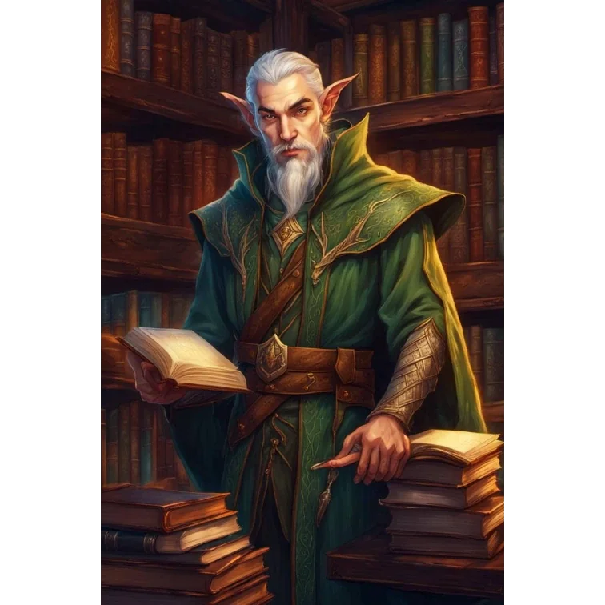

_Filozof z Akademii, autor „Mathematika Chalcodona”._

## Opis
Mistrz Chalcodon to sędziwy filozof i nauczyciel w Akademii. Chalcodon to elficki szlachcic i filozof. Specjalizuje się w matematyce i logice. Jest autorem paradoksu o Pythorze i żółwiu (wersja paradoksu Achillesa).

## Historia
W [[Sesja 15 - W kanałach Mytros]] Mistrz Chalcodon, który znał osobiście ponad 100 lat temu prababkę [[Felicjan Janus Twardowski|Felicjana]], [[Despina|Despinę]], przekazał drużynie informacje o jej zainteresowaniach i historii.

## Po wojnie
[[Felicjan Janus Twardowski|Felicjan]] pozyskał go dla [[Smoczy Lordowie|Zakonu Smoczych Lordów]]. Chalcodon daje Zakonowi dwie rzeczy naraz: trop do zagadki [[Despina|Despiny]], którą znał osobiście, i to, czego Felicjan sam nie może zapewnić — czas. Elf przeżyje go o stulecia i strzeże ciągłości nauk Zakonu, kiedy założyciela już nie będzie.
