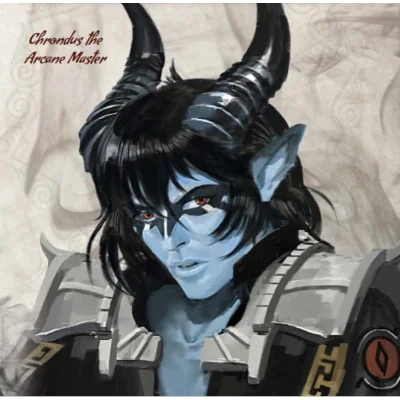

_Były doradca króla Acastusa i sługa Lutherii; zabity przez Versira w Sesji 81._

## Opis
Chondrus był tieflingiem, arkanistą i czarownikiem, którego największym atutem były teleportacja i podróże międzywymiarowe. Nosił czarny, elegancki strój. Był byłym doradcą króla Acastusa i członkiem rady Mytros, który znał strukturę [[Zakon Sydona|Zakonu Sydona]], a w rzeczywistości szpiegiem i wiernym sługą **[[Lutheria|Lutherii]]**. Zginął z ręki [[Versir|Versira]] w [[Sesja 81 - Bitwa o Mytros: Koszmar na Targu Minotaurów]].

Był niebieskoskórym tieflingiem, a w rzeczywistości kapłanem Lutherii wywodzącym się ze **[[Stygian Row]]**.

## Osobowość
Jego postawa emanowała dawną władzą i arogancją ([[Sesja 52 - Infiltracja Yonder]]). W służbie Sydona odczuwał tylko chłód fanatyzmu i uważał świat Sydona za tyranię owiniętą w sztandar boskości. Sydona miał za tępego, żądnego władzy tyrana, a Lutherię za obserwatorkę, która nie pragnie totalnej wojny i mogłaby sprzymierzyć się przeciw własnemu bratu.

Był pedantyczny, uwielbiał poprawiać drobne błędy innych, i uważał się za mądrzejszego od wszystkich. Był przebiegły, manipulujący i cyniczny; publicznie udawał pobożnego zwolennika Pięciu Bogów, wygłaszając płomienne mowy o nadziei na cud.

## Historia
Podczas narady w Sali Tronowej nalegał, by Vallus użyła swojej mocy, aby odegnać burze Sydona.

W [[Sesja 17 - Targ Minotaurów]] Gaius okazał nienawiść do Chondrusa, a w [[Sesja 18 - Cienie Mytros]] [[Versir]] wyruszył na jego poszukiwania. W [[Sesja 25 - Inauguracja Wielkich Igrzysk]] stał w czarnym eleganckim stroju na królewskim balkonie wśród bogów.

W [[Sesja 31 - Wyprawa na Themis]] załatwił drużynie wiele potrzebnych rzeczy, m.in. 3 beczki piwa, rufowe drzwi do ładowni i warsztat maga.

W [[Sesja 47 - Wyspa Mojr]] przestrzegał, by na wyspie niczego nie jeść ani pić, bo wody są skażone przez Morze Otchłani, i podzielił się wiedzą o [[Mojry|Mojrach]]. Dołączył do drużyny desantowej i, jak sam przyznał, zdążył polubić bohaterów.

W [[Sesja 48 - Pakty z Mojrami i Zew Chimery]] jako były doradca króla [[Acastus|Acastusa]] rozłożył przed drużyną na pokładzie [[Ultros|Ultrosa]] mapę [[Wyspa Yonder|Wyspy Yonder]], twierdzy [[Zakon Sydona|Zakonu Sydona]].

W [[Sesja 51 - Desant na Yonder]] jego rolą w planie było wejście do biblioteki Yonder w oficjalnej sprawie, z bohaterami jako dyskretną eskortą. W [[Sesja 52 - Infiltracja Yonder]] eskortowany przez nich wszedł do obozu i biblioteki, wykorzystując swój autorytet wobec strażników i grożąc im gniewem [[Gaius|Gaiusa]]; skontrował też czar paraliżu, rzucił czar latania i nieudaną polimorfię na Ajaxa.

W [[Sesja 53 - Koniec Yonder]] odwrócił się od Zakonu Sydona i stanął po stronie drużyny („Ja wybrałem wolność”). Rzucił Wall of Force, więżąc Gaiusa i jego smoczycę, a na znak [[Orion Xul|Oriona]] zdjął barierę. Gaius oskarżył go o paktowanie z Lutherią i zbieranie dla niej sekretów.

W [[Sesja 54 - Wyznanie Chondrusa]] przyznał, że służył Lutherii i w pewnym sensie wciąż jej służy. [[Versir]] zakuł go w kajdany i zamknął w celi na [[Ultros|Ultrosie]], konfiskując jego komponenty i księgę czarów; [[Felicjan Janus Twardowski|Felicjan]] przepisywał potem zaklęcia z [[Grimuar Chondrusa|grimuaru Chondrusa]], m.in. Polimorfię i Wygnanie.

W [[Sesja 55 - Egida Mytros]] pozostawał uwięziony na Ultrosie w porcie Mytros. [[Vallus]] poinformowała, że Acastus już go szuka z powodu niejasności w królewskiej księgowości, i odradziła wydanie go królowi, bo skończyłoby się to publiczną egzekucją; zasugerowała też, że mimo powiązań z Lutherią może być cennym źródłem informacji.

W [[Sesja 65 - Wyprawa w Otchłań]], w obawie przed jego zdradą po wpłynięciu na terytorium Tytanów, został zakuty w magiczne Kajdany Wymiarowe (Dimensional Shackles), uniemożliwiające teleportację i podróże międzywymiarowe, i oddany pod straż Andrzeja Drugiego i Włodka, bez kneblowania, o ile zachowuje spokój.

W [[Sesja 70 - Audiencja u Pani Snów]] bohaterowie zostawili go Lutherii jako „prezent” na [[Hypnos|Hypnosie]]. Bogini czuła się niekomfortowo przy jego dziwnej fascynacji i wcześniej odesłała go do Gaiusa.

W [[Sesja 81 - Bitwa o Mytros: Koszmar na Targu Minotaurów]] wiernie służył Lutherii: leżała na nim jak na podnóżku, a on z zachwytem znosił ciężar jej obcasów. Ruszył jej z pomocą w walce z drużyną, wznosząc barierę Wall of Force i ciskając Fire Bolt w Versira. Versir zabił go zaklęciem Toll the Dead, co doprowadziło do upadku bariery.
