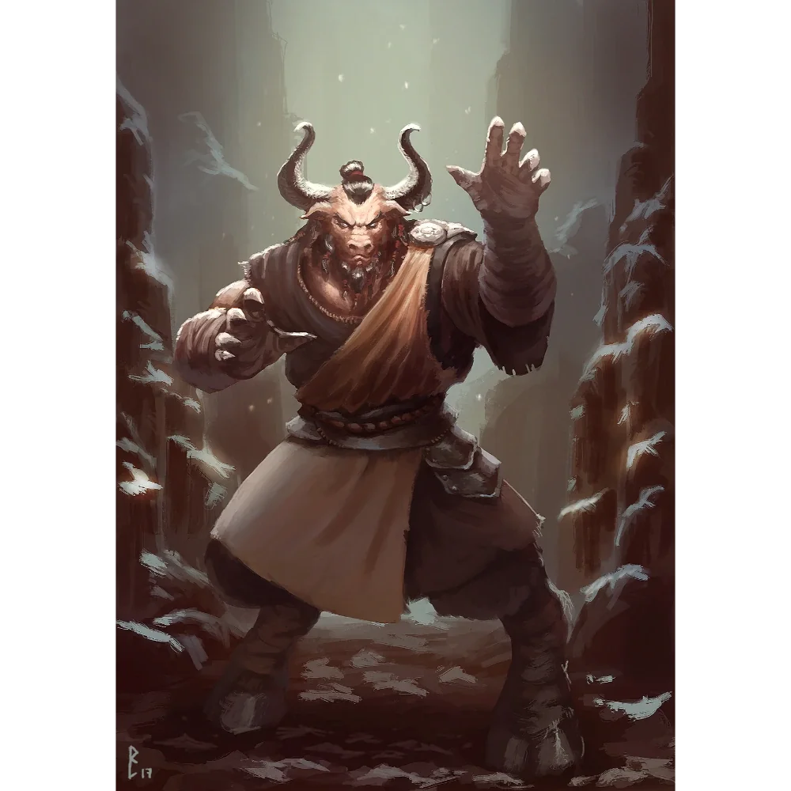

## Opis
Woźnica rydwanu, uczestnik Wielkich Igrzysk.

## Historia
W [[Sesja 29 - Rydwany i Jeden z Dziesięciu]] brał udział w wyścigu rydwanów. Gdy [[Felicjan Janus Twardowski|Felicjan]] po awarii własnego rydwanu wskoczył na jego pojazd, na ostatniej prostej został przez niego wyrzucony telekinezą, a Felicjan przejął kontrolę i wygrał wyścig tuż przed metą.
