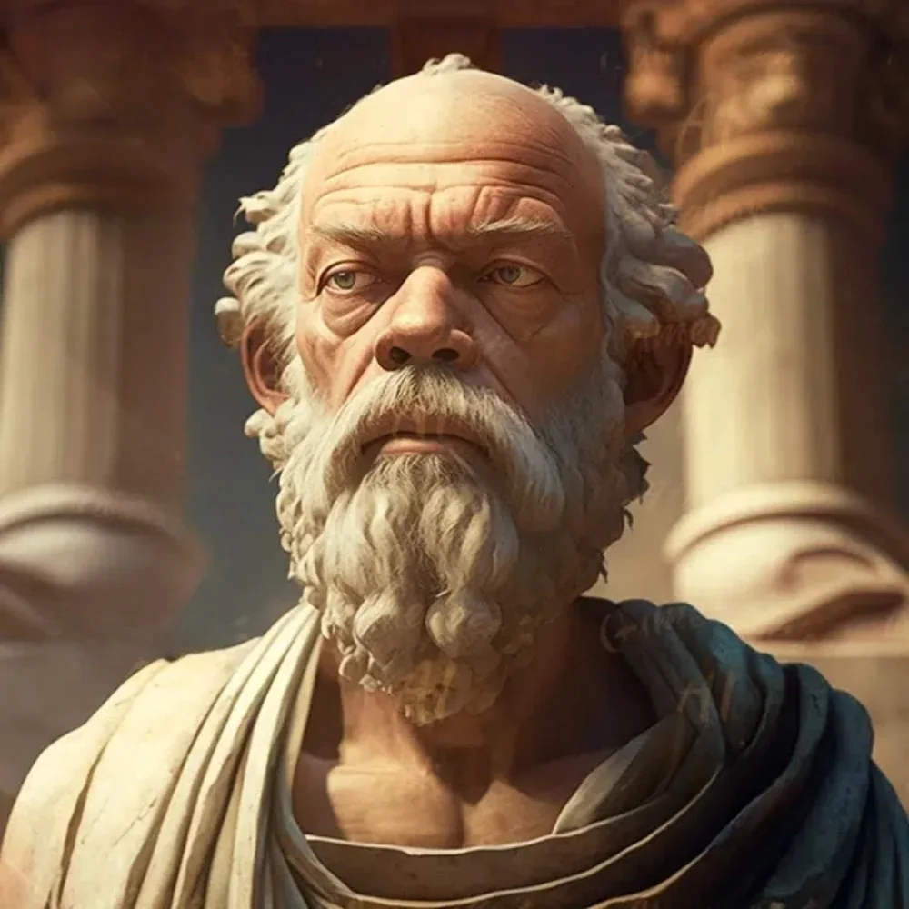

_Filozof z Akademii Mytros._

W [[Sesja 15 - W kanałach Mytros]] przybył do [[Felicjan Janus Twardowski|Felicjana]] z informacją o jego tajemniczej prababce, [[Despina|Despinie]].

Był jednym z filozofów z [[Akademia Mytros|Akademii]] i przekazał wieści od Mistrza [[Chalcodon|Chalcodona]].
