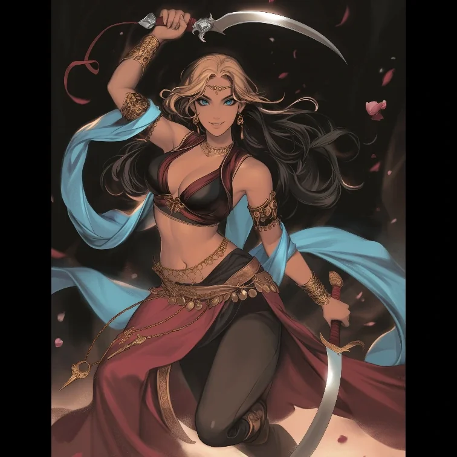

_Dowódczyni krasnoludów w Bitwie o Mytros._

## Opis
Falana dowodziła krasnoludzkim oddziałem w obronie [[Mytros]]. Zastąpiła w tej roli dotychczasowego dowódcę krasnoludów.

## Historia
- [[Sesja 77 - Bitwa o Mytros: Upadek Icarusa]]: przy strategicznych przesunięciach w obronie miasta Falana zastąpiła dotychczasowego dowódcę krasnoludów. W tym samym czasie [[Corinna]] objęła dowództwo nad jednym z legionów, a [[Felicjan Janus Twardowski|Felicjan]] osobiście dołączył do magów.
