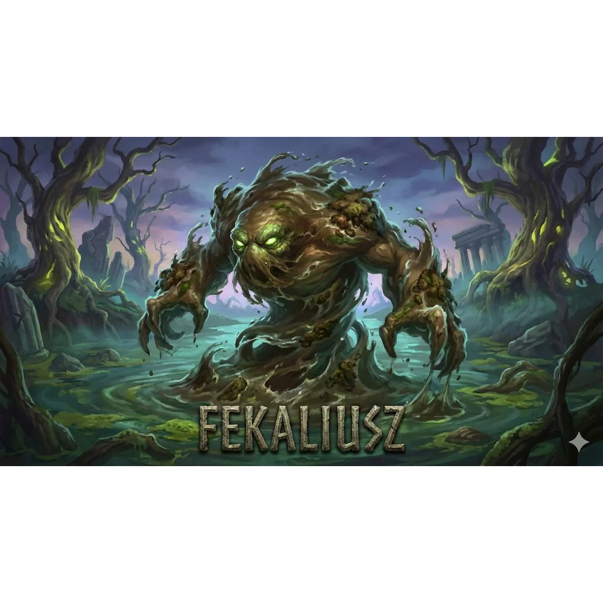

_Żywiołak fekaliów, który zatykał kanały Mytros._

Potężny żywiołak fekaliów (nieczystości), na którego drużyna natrafiła w północnej części kanałów Mytros.

W [[Sesja 15 - W kanałach Mytros]] drużyna napotkała go na północy [[Kanały Mytros|kanałów Mytros]] i stoczyła z nim ciężką walkę, w której zginął [[Hoobert]].

W [[Sesja 68 - Arena Krzywoprzysięstwa]] pojawił się jako żywiołak ścieków, który w trzeciej fali walk na arenie, u boku [[Demetria|Demetrii]], próbował utopić drużynę w wirze nieczystości. Użył legendarnej akcji, przyzywając „Wir Gówna”, który pokrył centrum areny lepką, cuchnącą substancją, i został pokonany.
