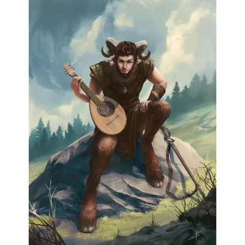

_Satyr-muzyk w [[Satyrzy Ogon]]._

## Opis
Fryxon to satyr-bard przebywający w tawernie [[Satyrzy Ogon]] ([[Sesja 21 - Ukryte pragnienia Ismene]]).

Przyjaźni się z [[Julius|Juliusem]] i gra w jego tawernie. Uwielbia psoty. Jego muzyka potrafi usypiać agresorów.
