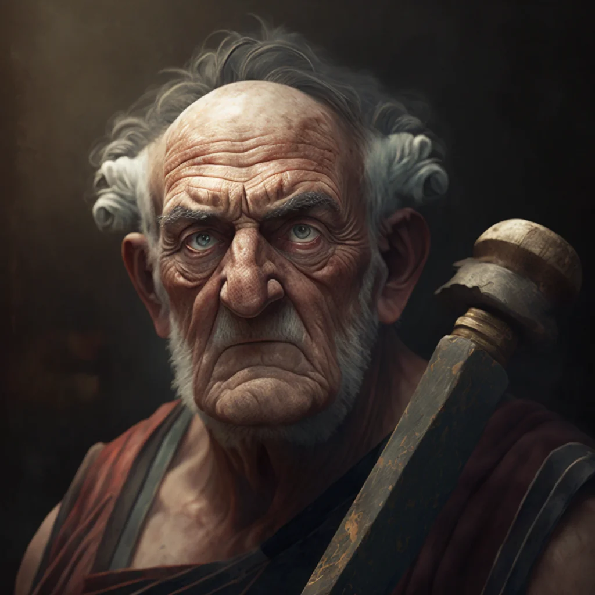

_Emerytowany centurion i właściciel zbrojowni._

## Opis
Grimmik to weteran wojen z centaurami, który prowadzi **Grimmik's Armory** na **[[Agora w Mytros|Wielkiej Agorze]]**. Jest dumny ze swojej służby dla miasta. Sprzedaje broń i zbroje sprowadzane z Estorii.

## Historia
W [[Sesja 19 - Pojedynek z Rozpruwaczem]] dał [[Orestes|Orestesowi]] bukłak na browar dla [[Pholon|Pholona]].
