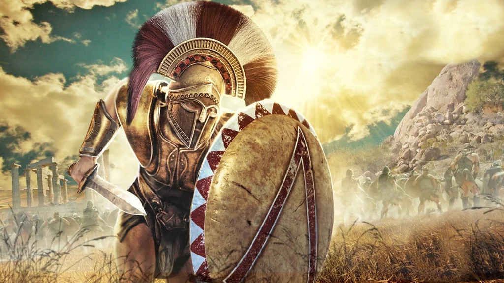

_Dowódca obozu wojskowego Mytros_

## Historia
Dowódca [[Obóz wojskowy Mytros|obozu wojskowego Mytros]] ([[Sesja 1 - Wielki Dzik]]).

W [[Sesja 1 - Wielki Dzik]] jego obóz, leżący na drodze do [[Świątynia Wyroczni|Świątyni Wyroczni]], odwiedziła drużyna po pokonaniu Wielkiego Dzika.
