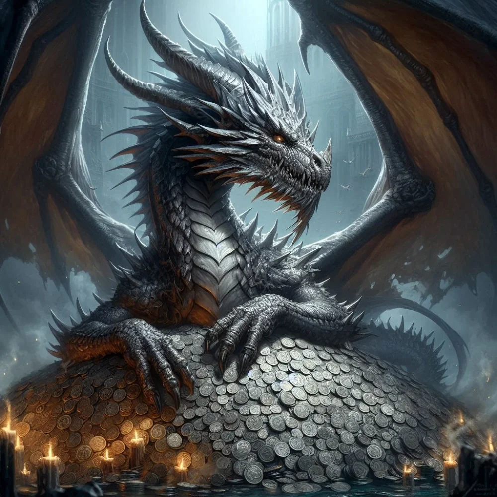

_Potężny srebrny smok, niegdyś wierzchowiec króla Acastusa. Zmutowany w bitwie o Mytros, zginął w kolosseum w [[Sesja 77 - Bitwa o Mytros: Upadek Icarusa|sesji 77]]._

## Opis
Wierzchowiec króla [[Acastus|Acastusa]], srebrny smok.
Największy smok jakiego widziano na kontynencie. Był dorosłym srebrnym smokiem (*Adult silver dragon*), ale tylko fizycznie. Z powodu klątwy [[Mojry|Mojr]], Icarus został gwałtownie postarzony, nadal miał naiwny umysł smoczątka.
Spędzał czas kradnąc bydło i przelewiając wody w porcie, co wszyscy ignorowali ze strachu przed królem. Acastus obnosił się z nim podczas festiwali.

## Historia
W [[Sesja 17 - Targ Minotaurów]] Acastus i [[Gaius]] przybyli do Świątyni Pięciu na smokach Icarus i [[Argyn]]. W [[Sesja 25 - Inauguracja Wielkich Igrzysk]] Icarus został przedstawiony jako srebrny smok króla.

W [[Sesja 76 - Bitwa o Mytros: Pierwsza Fala]], podczas obrony miasta przed tsunami zsyłanym przez [[Sydon|Sydona]], [[Acastus]] w desperacji wbił w szyję Icarusa tajemniczą, pulsującą sinym światłem włócznię. Wbicie włóczni wywołało u Icarusa drastyczną mutację – urósł, pokrył się kolcami, a obca magia pochłonęła jego umysł, pogrążając go w morderczym szale. Zmutowany smok wypuścił strugę zimna, zamrażając tsunami w lodową górę i ratując miasto, lecz zaraz potem zrzucił Acastusa (uratowanego przez [[Apasia|Apasię]]) i zaczął bezładnie atakować wszystko dookoła, plując lodem na cywilów i żołnierzy obu stron. Został zaatakowany przez połączone siły smoczych bogów.

W [[Sesja 77 - Bitwa o Mytros: Upadek Icarusa]] **zginął** na piaskowej arenie [[Stadion Mytros|kolosseum]]. Zmutowany, pokryty kolcami smok, otoczony aurą ciemności pożerającą jego łuski, rzucił *Hold Monster* na drużynę, lecz [[Felicjan Janus Twardowski|Felicjan]] przekierował zaklęcie z powrotem na niego, paraliżując go własną mocą. Jego potężny **paraliżujący oddech** (najpierw inkapacytacja, potem paraliż) dwukrotnie wytoczył się ku obrońcom, a próby ataku na [[Versir|Versira]] kończyły się trzykrotnym wyrzuceniem jedynki na kostce. [[Orestes]] **Strike of the Hill Giant** powalił bestię na ziemię, a [[Arevon Elorrenthi|Arevon]] zadał ostateczny cios radiantnym ostrzem, rozbijając aurę ciemności mutanta. Ze zwłok Icarusa drużyna pozyskała róg, łuski i inne komponenty. Bogini [[Mytros (Bogini)|Mytros]] nagrodziła zwycięstwo dwoma nowymi Miracle Pointami.
