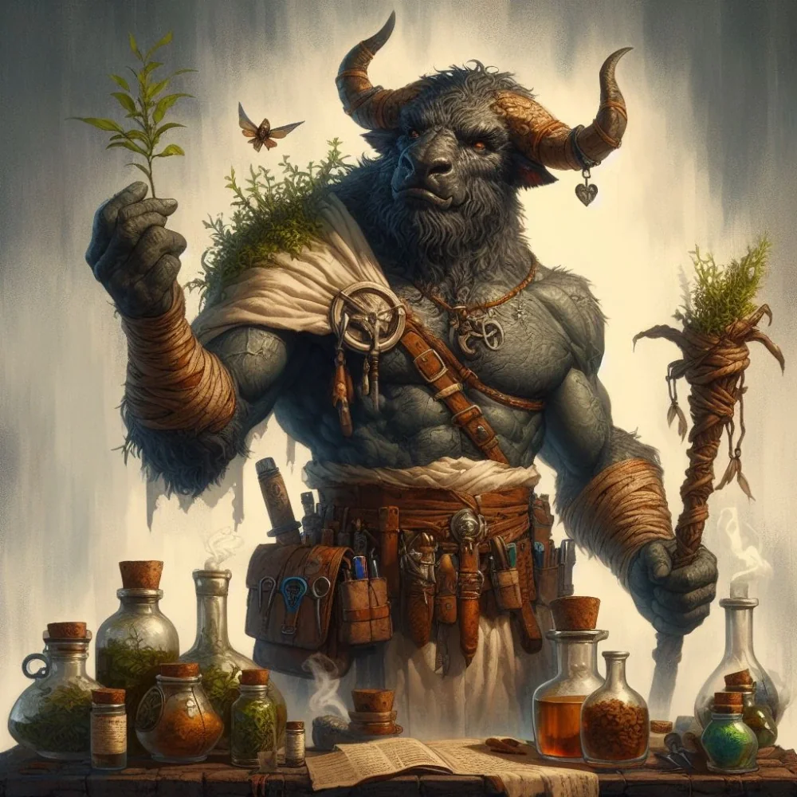

_Minotaur zielarz z Gniazda Zapomnianych._

Jankas to minotaur, który służy jako lekarz i zielarz dla społeczności [[Gniazdo Zapomnianych]]. Niegdyś, w lepszych czasach dla minotaurów, szkolił się na medyka. Teraz warzy mikstury z grzybów i roślin rosnących w kanałach. Marzy o powrocie czasów, gdy minotaury były szanowane.
