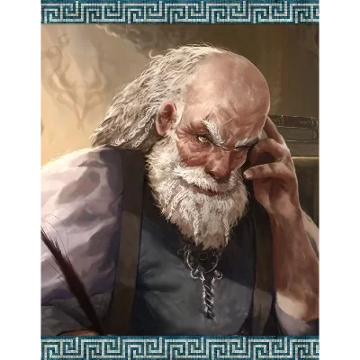

_Właściciel tawerny The Satyr's Tail._

## Opis
Julius jest właścicielem tawerny **[[Satyrzy Ogon]]**.

Julius to podły, jednoręki starzec i były handlarz niewolników. Stracił rękę i statek w starciu z piratami. Nienawidzi, gdy ktoś przeszkadza jego klientom.

## Historia
W [[Sesja 19 - Pojedynek z Rozpruwaczem]] został bukmacherem prywatnego wydarzenia zorganizowanego przez [[Maximus|Maximusa]]; zakłady przyjmował jako właściciel tawerny [[Satyrzy Ogon]].
