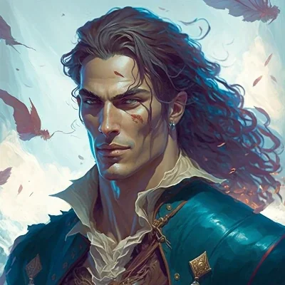

_Syn Pythora i śmiertelniczki._

## Opis
Kalistor jest jednym z synów boga **[[Pythor|Pythora]]**. Pracuje w luksusowym domu uciech **[[Syrenie Gniazdo]]** w Mytros. Twierdzi (zgodnie z prawdą), że jest synem boga, co jest jedną z atrakcji dla klientów.

## Historia
W [[Sesja 31 - Wyprawa na Themis]] dołączył do drużyny (załogi) przed wyprawą na [[Themis]], razem z [[Corinna|Corinną]], [[Lyra|Lyrą]] i innymi.

W [[Sesja 85 - Cienie nad Arezją]] zasnął pijany na ławie w barze na [[Ultros|Ultrosie]]. Gdy po zamknięciu obudził się i wyszedł za potrzebą na rufę, nakrył czterech włamywaczy przy kajucie kapitańskiej. Dźgnęli go sztyletami i uciekli, gdy narobił hałasu. Przeżył dzięki kapłanom, a [[Orestes]] w nagrodę stawia mu picie na koszt kapitana.
