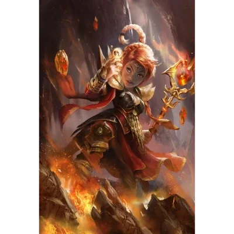

_Gnomi kapłan i filozof, autor "Dialogów Kerodotos"._

## Opis
Kerodotos to gnomi kapłan, który wykłada w **[[Akademia Mytros|Akademii]]**. Znany jest ze swoich zagadek logicznych (paradoks sfinksa), ceni mądrość oraz spryt.
