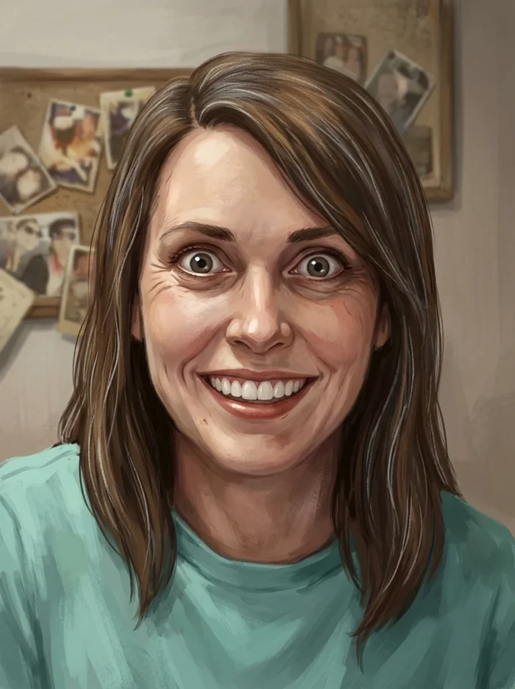

_Najemniczka na służbie [[Taran Neurdagon|Tarana Neurdagona]], dawna towarzyszka [[Bohaterowie Przepowiedni|Bohaterów Przepowiedni]]._

## Opis
Wojowniczka i towarzyszka broni drużyny, potrafiąca przybierać zwierzęce formy — w [[Sesja 35 - W Wężowym Uścisku|walce z Amazonkami]] niosła [[Orestes|Orestesa]] jako koń. Po wojnie została przez [[Orion Xul|Oriona]] zostawiona bez rozmowy, bez wyjaśnienia i bez zamknięcia. Mieszka w [[Mytros]] i przyjęła dobrze płatną służbę u [[Taran Neurdagon|Tarana Neurdagona]].

## Osobowość
Przez całą wyprawę była bezwarunkowo lojalna wobec [[Orion Xul|Oriona]]; on tej lojalności nigdy nie odwzajemnił.

## Historia
Lyra dołączyła do drużyny przed wyprawą na [[Themis]] (w [[Sesja 31 - Wyprawa na Themis]]) i towarzyszyła bohaterom przez kolejne etapy odysei. W [[Sesja 35 - W Wężowym Uścisku]] [[Orestes]] dosiadł jej, gdy przemieniła się w konia. Towarzyszyła też bohaterom podczas szturmu na [[Latająca Forteca Smoczych Lordów|Latającą Fortecę Smoczych Lordów]] (w [[Sesja 59 - Koniec Imprezy]]).

W epilogu wyprawy (w [[Sesja 84 - Świt Nowej Ery]]) drużyna rozliczała się z dawnymi towarzyszami broni i przy imieniu Lyry zatrzymała się najdłużej: przez całą wyprawę wykorzystywano ją raz za razem, nie dając nic w zamian. [[Arevon Elorrenthi|Arevon]] rozróżnił „przygarnąć ją" i „dać jej nadzieję" jako dwie zupełnie różne rzeczy — [[Orion Xul|Orion]] nie zrobił ani jednego, ani drugiego. Zostawił ją bez rozmowy, bez wyjaśnienia i bez zamknięcia, powtarzając dokładnie ten błąd, który przez całą wyprawę wypominał [[Pythor|Pythorowi]] wobec [[Hexia|Hexii]].

W [[Sesja 85 - Cienie nad Arezją]] wyszła drużynie naprzeciw w [[Obóz pod Arezją|obozie pod Arezją]], w skórzanej zbroi, z krótkim mieczem i łukiem przy pasie. Przywitała [[Orion Xul|Oriona]], a zapytana, gdzie mieszka, odparła z przekąsem, że w [[Mytros]], i że po wojnie przyjęła dobrze płatną służbę u Tarana. Po jego aresztowaniu pakowała obóz z resztą żołnierzy, niezadowolona z utraty zarobku.
