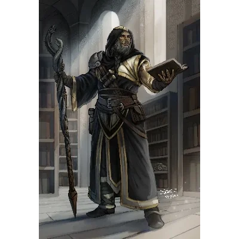

_Filozof z Akademii, autor "Paradoxia Machaona"._

## Opis
Machaon to półork i mag, jeden z czołowych filozofów w **[[Akademia Mytros|Akademii]]**. Jest znany ze swoich rozważań na temat tożsamości i zmiany (paradoks statku *Valorous*), ceni kreatywne, nieszablonowe myślenie.

Wykłada w Akademii o automatonach.

## Historia
W [[Sesja 21 - Ukryte pragnienia Ismene]] odwiedzili go bohaterowie. Na jego zajęcia uczęszczała [[Ismene Neurdagon|Ismene]], która interesowała się nekromancją i tworzeniem protez do amputowanych części ciała.
